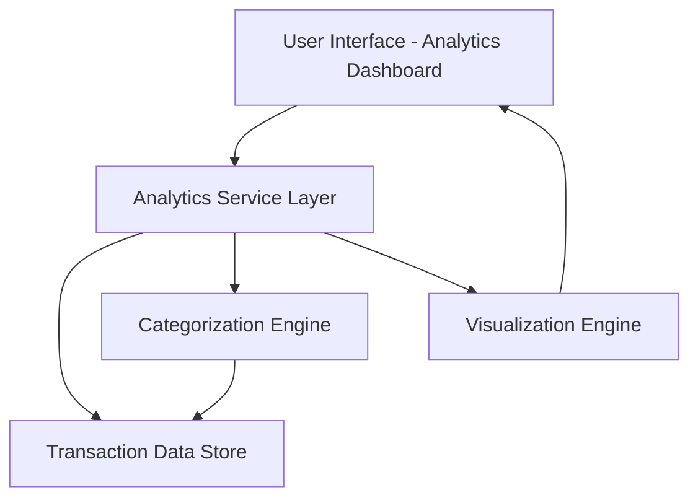

#### 1. High-Level Design

- **Summary:** This epic delivers interactive visualizations and analytics capabilities for credit card spending patterns. Users can analyze monthly trends, card-wise breakdowns, and category-wise spending distributions across predefined categories (Food & Dining, Fuel, Shopping, Travel, Entertainment, Utilities, Healthcare, Education, Miscellaneous). The solution provides actionable insights through charts and graphs to enable data-driven financial decisions.

- **Component Flow:**

- **Integration Points:**
  - **Upstream:** Transaction Management System (provides transaction data)
  - **Upstream:** Categorization Engine (assigns transactions to spending categories)
  - **Lateral:** Dashboard KPIs system (for consistent data presentation)

- **Key Assumptions:**
  - Transaction categorization is performed automatically by the categorization engine; manual recategorization is out of scope.
  - Analytics data aggregation is performed on-demand or through periodic batch processing; specific refresh frequency not defined in epic.

- **NFR Highlights:** Analytics visualizations must render within 2 seconds; system must support interactive filtering and drill-down capabilities; charts must be responsive and adapt to different screen sizes.

- **Data Flow:** Transaction data flows from the Transaction Data Store to the Analytics Service Layer, which requests categorization from the Categorization Engine. The Analytics Service aggregates data by month, card, and category, then passes structured datasets to the Visualization Engine. The Visualization Engine renders interactive charts (line charts for trends, pie/bar charts for breakdowns) and returns them to the User Interface for display. User interactions (filters, drill-downs) trigger new data requests through the same flow.

#### 2. Validation Report

- **Requirements Coverage:** The design covers all stated scope elements including monthly spend trends visualization, card-wise spend analysis, category-wise spending breakdown, interactive charts and graphs, spending pattern identification, multi-dimensional analytics, and predefined spending categories. The architecture supports the required NFRs for rendering performance (2 seconds), interactive filtering, and responsive design. Integration dependencies with transaction management system, categorization engine, and dashboard KPIs are addressed through defined integration points. Out-of-scope items (real bank integration, predictive analytics, budget recommendations, spending alerts, custom category creation, export functionality) are explicitly excluded from the design.