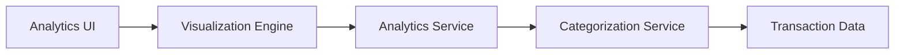

#### 1. High-Level Design

- **Summary:** This epic provides interactive analytics and visualization capabilities for spending pattern analysis, delivering category-wise breakdowns (Food & Dining, Fuel, Shopping, Travel, Entertainment, Utilities, Healthcare, Education, Miscellaneous) and monthly spend trends through visual representations to enable data-driven financial decisions.

- **Component Flow:**

- **Integration Points:** 
  - Transaction categorization service or logic for classifying transactions into predefined categories
  - Charting library or visualization framework for rendering analytics
  - Transaction data source for raw spending data

- **Key Assumptions:** 
  - Transactions will be auto-categorized using predefined rules or ML-based classification
  - Analytics will support time-range filtering (monthly, quarterly, yearly) for trend analysis

- **NFR Highlights:** Visualizations must render quickly and be interactive; Analytics calculations must be accurate and real-time or near-real-time; Charts must be responsive and accessible across different screen sizes

#### 2. Validation Report

- **Requirements Coverage:** The design comprehensively covers the epic's scope including category-wise spending visualization, monthly spend trend analysis, interactive charts, spending pattern identification, and all nine predefined categories. The architecture with dedicated Categorization Service and Visualization Engine ensures accurate, real-time analytics calculations and responsive, interactive chart rendering as mandated by the NFRs.