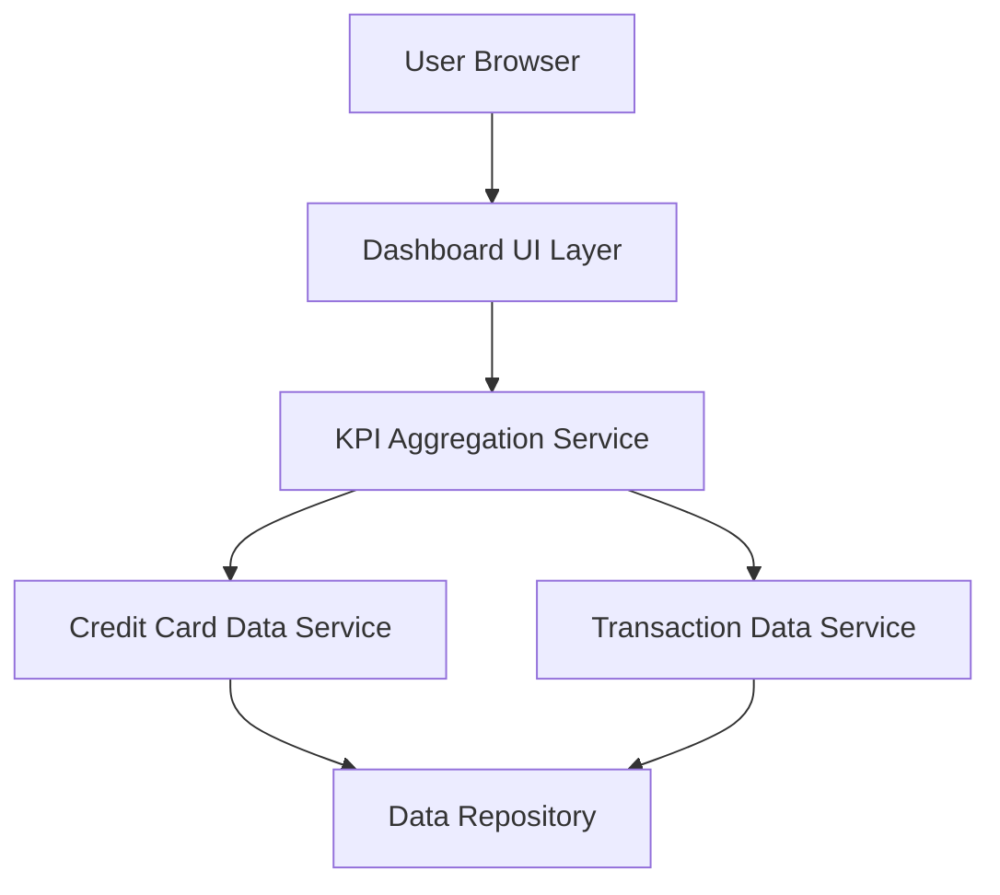

#### 1. High-Level Design

- **Summary:** This epic delivers a responsive, consolidated dashboard that displays all user credit cards and critical KPIs (monthly spend, total credit limit, available credit, outstanding amounts) in a unified interface, serving as the primary entry point for credit card portfolio visibility and financial health monitoring.

- **Component Flow:**

- **Integration Points:** 
  - Credit card data source or mock data service for retrieving card information
  - Transaction data service for balance and spending details
  - Data repository for card and transaction data persistence

- **Key Assumptions:** 
  - KPI calculations will be performed server-side and cached for performance optimization
  - Mock data service will simulate real-time data updates until actual integration is implemented

- **NFR Highlights:** System must support responsive design across desktop, tablet, and mobile devices; Dashboard load time must be optimized for quick access to KPIs; UI must be accessible and compliant with modern web standards

#### 2. Validation Report

- **Requirements Coverage:** The design fully covers the epic's stated scope including dashboard interface development, KPI calculations (monthly spend, credit limit, available credit, outstanding amounts), multi-card consolidated view, and responsive layout. All NFRs regarding responsiveness, performance, and accessibility are addressed through the layered architecture with dedicated KPI aggregation service and UI optimization considerations.