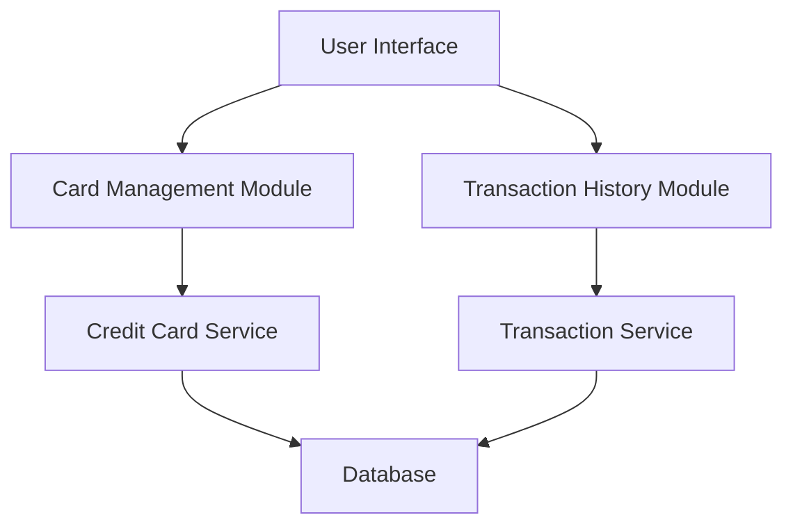

#### 1. High-Level Design

- **Summary:** This epic enables users to view and manage multiple credit cards with detailed transaction history for each card, providing card-specific details, transaction records, and card-wise filtering capabilities to track spending activities and usage patterns at a granular level.

- **Component Flow:**

- **Integration Points:** 
  - Credit card data repository or service for card information retrieval
  - Transaction data service or database for transaction records
  - Card-wise filtering and analysis capabilities

- **Key Assumptions:** 
  - Transaction data will be paginated to handle large transaction volumes efficiently
  - Card details will include masked card numbers for security compliance

- **NFR Highlights:** System must handle display of multiple cards efficiently; Transaction queries must return results within acceptable response times; Data must be presented in a clear, organized manner for easy user comprehension

#### 2. Validation Report

- **Requirements Coverage:** The design addresses all aspects of the epic including multiple credit card display, card details view, transaction listing, card-wise filtering, transaction history tracking, and spend analysis visualization. The modular architecture with separate Card Management and Transaction History modules ensures efficient handling of multiple cards and optimized transaction queries as specified in the NFRs.