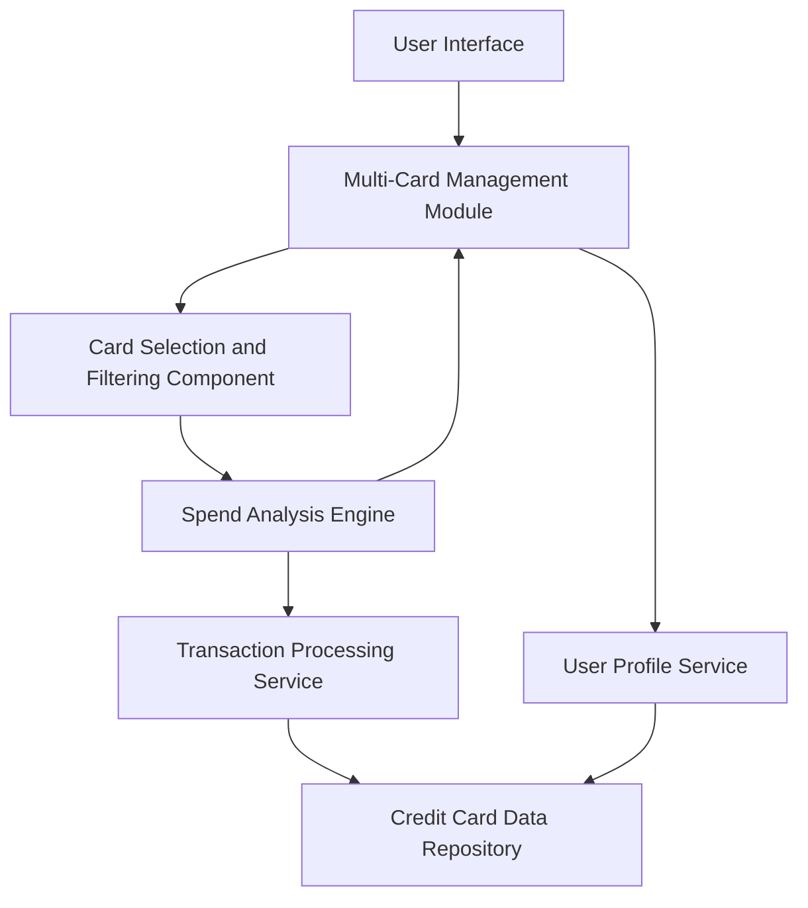

### 1. High-Level Design

**Summary:**  
This epic enables users to manage and monitor multiple credit cards from a unified interface. Users can view individual card details, perform card-wise spend analysis, track monthly spend trends, and monitor card utilization metrics across their entire credit card portfolio (up to 10 cards per user).

**Component Flow:**

**Integration Points:**
- **Credit Card Data Repository:** Stores and retrieves card information for multiple cards
- **Transaction Processing Service:** Provides spend calculations and transaction history
- **User Profile Service:** Validates card ownership and user-card associations

**Key Assumptions:**
- Card utilization is calculated as (current balance / credit limit) × 100
- Monthly spend trends aggregate transactions on a calendar month basis

**NFR Highlights:**  
System must support at least 10 credit cards per user, card data retrieval must complete within 1 second, interface must be responsive across all device sizes, data accuracy must be maintained across all card calculations

### 2. Validation Report

**Requirements Coverage:**  
The design addresses all scope elements including multiple credit card display, card-wise spend analysis, monthly spend trends visualization, individual card details view, card selection and filtering, and card utilization metrics. The architecture supports the NFR requirements for scalability (10+ cards), performance (1-second retrieval), responsiveness, and data accuracy. All dependencies (credit card data repository, transaction processing service, user profile service) are properly integrated.