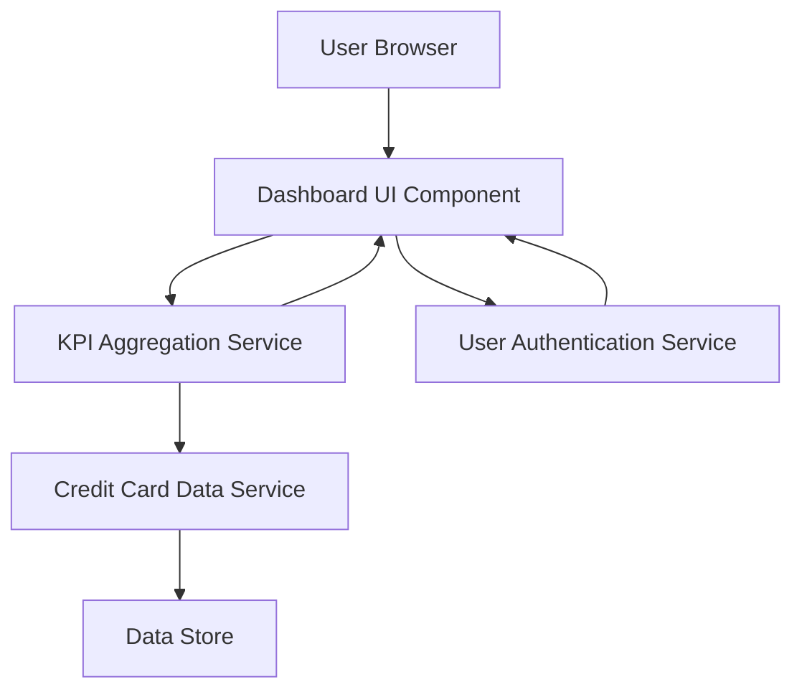

### 1. High-Level Design

**Summary:**  
This epic delivers a consolidated dashboard interface that displays key performance indicators (KPIs) for a user's credit card portfolio. The dashboard provides real-time visibility into monthly spend, total credit limit, available credit, and outstanding amounts, enabling users to assess their financial health at a glance.

**Component Flow:**

**Integration Points:**
- **Credit Card Data Service:** Retrieves card balances, transaction data, and credit limits
- **User Authentication Service:** Validates user identity and secures access to dashboard
- **Data Store:** Backend repository for credit card and transaction information

**Key Assumptions:**
- Data refresh occurs at regular intervals (assumed real-time polling or push mechanism not explicitly defined)
- KPI calculations (available credit, outstanding amounts) follow standard financial formulas

**NFR Highlights:**  
Dashboard must load within 2 seconds, support responsive design across desktop and mobile devices, handle real-time data refresh, support concurrent access for multiple users

### 2. Validation Report

**Requirements Coverage:**  
The design covers all stated scope items including monthly spend display, total credit limit aggregation, available credit calculation, outstanding amount tracking, responsive dashboard layout, and KPI visualization components. The architecture supports the required NFRs for performance (2-second load time), responsiveness, real-time refresh, and concurrent access. All identified dependencies (credit card data service and user authentication service) are integrated into the component flow.