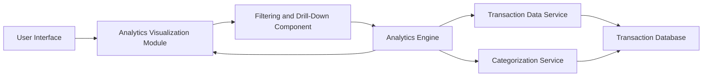

### 1. High-Level Design

**Summary:**  
This epic provides interactive analytics and visualizations that help users understand spending patterns across multiple categories (Food & Dining, Fuel, Shopping, Travel, Entertainment, Utilities, Healthcare, Education, Miscellaneous). The solution delivers actionable insights through category-wise breakdowns, interactive charts, and spending trend identification to support informed budgeting decisions.

**Component Flow:**

**Integration Points:**
- **Transaction Data Service:** Retrieves categorized transaction records (up to 10,000 per user)
- **Analytics Engine:** Processes spending patterns and generates insights
- **Categorization Service:** Automatically classifies transactions into predefined categories

**Key Assumptions:**
- Transaction categorization is automated using predefined rules or ML-based classification
- Spending trends are calculated based on historical transaction data with configurable time periods

**NFR Highlights:**  
Analytics visualizations must render within 3 seconds, support filtering and drill-down capabilities, handle transaction datasets of up to 10,000 records per user, maintain data accuracy in category calculations, support interactive chart interactions with sub-second response time

### 2. Validation Report

**Requirements Coverage:**  
The design comprehensively covers all scope requirements including category-wise spending visualization, interactive charts and graphs, spending pattern analysis, transaction categorization, multi-category filtering, spending trend identification, and category breakdown by percentage and amount. The architecture supports all NFRs for performance (3-second rendering, sub-second interactions), scalability (10,000 records), filtering capabilities, and data accuracy. All dependencies (transaction data service, analytics engine, categorization service) are appropriately integrated into the solution.