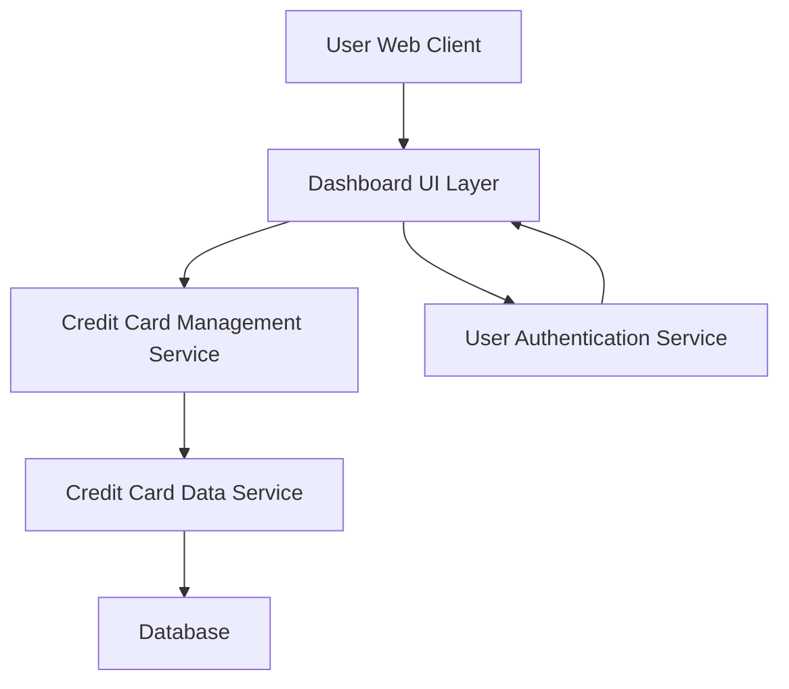

#### 1. High-Level Design

- **Summary:** This epic delivers a consolidated credit card portfolio dashboard that displays key performance indicators (KPIs) for multiple credit cards. Users can view monthly spend, total credit limit, available credit, and outstanding amounts across all their cards in a responsive interface, enabling centralized financial health monitoring and credit utilization tracking.

- **Component Flow:**

- **Integration Points:**
  - **Upstream:** User Authentication Service (for secure access control)
  - **Downstream:** Credit Card Data Service (for retrieving card details, balances, and credit limits)

- **Key Assumptions:**
  - Credit card data is refreshed in near real-time or at defined intervals (e.g., every 5 minutes) to maintain dashboard accuracy.
  - KPI calculations (available credit, utilization) are performed server-side to ensure consistency across devices.

- **NFR Highlights:** System must support responsive design across desktop, tablet, and mobile devices; Dashboard load time must be under 2 seconds; Must handle concurrent viewing of up to 10 credit cards per user.

#### 2. Validation Report

- **Requirements Coverage:** The design fully covers the epic's stated scope including dashboard KPIs display, multiple credit card view, monthly spend tracking, credit limit aggregation, available credit calculation, outstanding amount display, and responsive layout. All integration dependencies (credit card data service and user authentication service) are accounted for in the architecture. The component flow supports the NFR requirements for responsive design and sub-2-second load times through efficient service-oriented architecture.