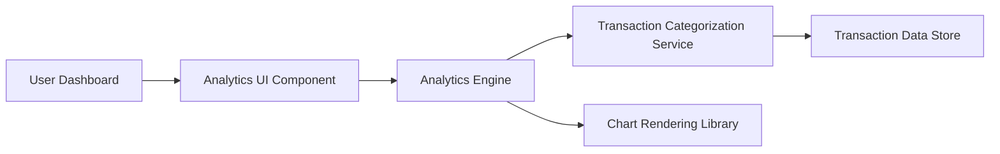

#### 1. High-Level Design

- **Summary:** This epic delivers interactive spending analytics through category-wise visualizations and monthly trend analysis. Users can explore spending patterns across 9 predefined categories (Food & Dining, Fuel, Shopping, Travel, Entertainment, Utilities, Healthcare, Education, Miscellaneous) and perform card-wise spend analysis to understand usage patterns and identify opportunities for financial optimization.

- **Component Flow:**

- **Integration Points:**
  - **Upstream:** Transaction Categorization Service (for assigning categories to transactions)
  - **Upstream:** Analytics Engine (for data aggregation and trend calculation)
  - **Downstream:** Chart Rendering Library (for visualization generation)

- **Key Assumptions:**
  - Transactions are automatically categorized using predefined rules or machine learning models maintained by the categorization service.
  - Historical data aggregation for 12 months is pre-computed or cached to meet the 2-second rendering requirement.

- **NFR Highlights:** Analytics visualizations must render within 2 seconds; System must support real-time data aggregation for up to 12 months of historical data; Charts must be responsive and interactive across all device types.

#### 2. Validation Report

- **Requirements Coverage:** The design comprehensively covers all scope elements including category-wise spending visualization, monthly spend trend analysis, card-wise spend analysis, interactive charts and graphs, spending pattern identification, and multi-category support for 9 spending categories. The architecture addresses NFR requirements through dedicated analytics engine for efficient data aggregation, chart rendering library for responsive visualizations, and integration with transaction categorization service. The component flow supports sub-2-second rendering and 12-month historical data analysis as specified.