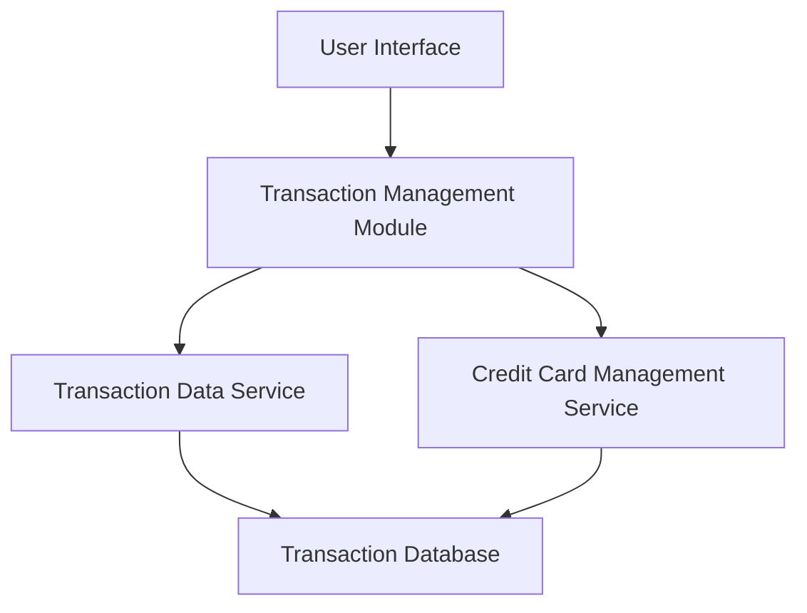

#### 1. High-Level Design

- **Summary:** This epic provides comprehensive transaction viewing and tracking capabilities across multiple credit cards. Users can access detailed transaction histories with filtering and sorting capabilities, enabling spending activity monitoring, charge verification, and maintenance of accurate credit card usage records. The system supports viewing and managing large transaction datasets.

- **Component Flow:**

- **Integration Points:**
  - **Upstream:** Transaction Data Service (for retrieving transaction records)
  - **Upstream:** Credit Card Management Service (for associating transactions with specific cards)

- **Key Assumptions:**
  - Transactions are stored with standardized timestamps and card identifiers to enable efficient multi-card aggregation.
  - Filtering and sorting operations are optimized through database indexing on key fields (date, amount, card ID, category).

- **NFR Highlights:** System must support display of at least 1000 transactions per user; Transaction data retrieval must complete within 3 seconds; Must maintain transaction data integrity and accuracy.

#### 2. Validation Report

- **Requirements Coverage:** The design addresses all core requirements including transaction listing, transaction details view, multi-card transaction aggregation, transaction history access, and responsive transaction interface. The architecture supports the NFR requirements for handling 1000+ transactions with sub-3-second retrieval through dedicated transaction data service and optimized data access patterns. Integration dependencies with transaction data service and credit card management service are properly incorporated.