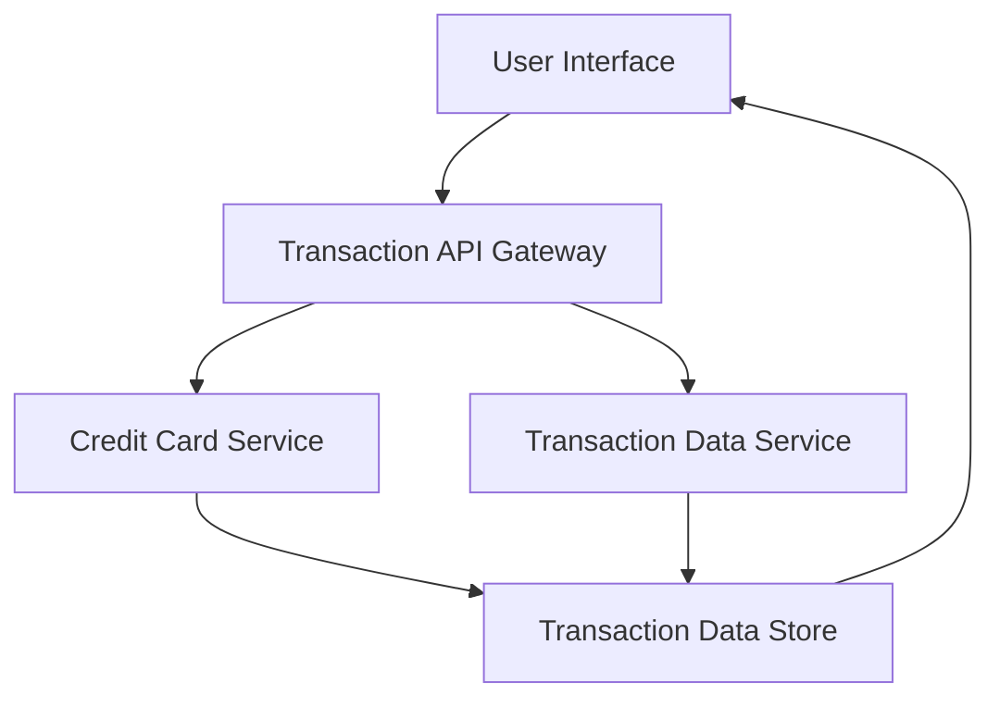

#### 1. High-Level Design

- **Summary:** This epic provides users with the ability to view and monitor all credit card transactions across their multiple cards. Users can access detailed transaction history, enabling them to track their spending activities and verify charges made on their credit cards.

- **Component Flow:**

- **Integration Points:**
  - **Upstream:** Transaction data service for retrieving transaction records
  - **Internal:** Credit card service for linking transactions to specific cards
  - **Backend:** Transaction Data Store for persisting transaction records

- **Key Assumptions:**
  - Transaction history will include a default time range (e.g., last 90 days) with the ability to filter by date range, card, or other criteria.
  - Transaction details include standard fields such as date, merchant name, amount, category, and card identifier.

- **NFR Highlights:** System must support retrieval and display of large transaction volumes efficiently; transaction data must be displayed with minimal latency; interface must be responsive across all device types.

- **Data Flow:** User requests transaction history via the UI, which calls the Transaction API Gateway. The gateway queries the Transaction Data Service to retrieve transaction records from the Transaction Data Store. The Credit Card Service links transactions to specific cards, enabling multi-card transaction aggregation. The retrieved transaction data, including detailed transaction history and transaction details, is returned to the UI and displayed to the user in a responsive interface.

#### 2. Validation Report

- **Requirements Coverage:** The design covers all stated scope elements including transaction viewing, transaction history display, multi-card transaction aggregation, and transaction details access. The architecture supports the NFRs for efficient retrieval and display of large transaction volumes, minimal latency, and responsive interface across all device types. Integration with the transaction data service and credit card service is accounted for. Out-of-scope items (real bank integration, card payments, fund transfers, loans, payment gateway integration) are not included in the design.