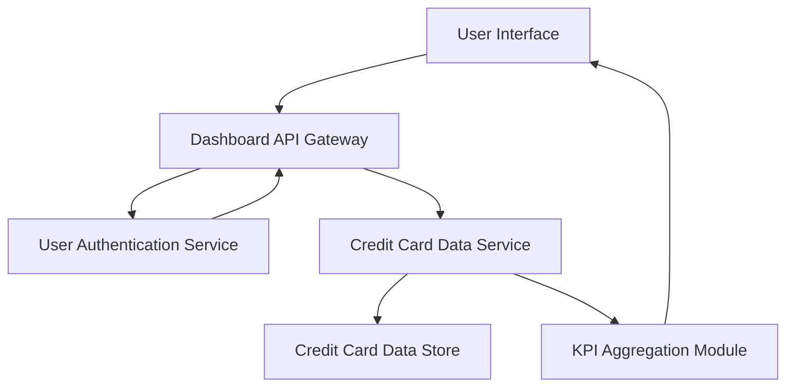

#### 1. High-Level Design

- **Summary:** This epic enables users to view a consolidated dashboard displaying key performance indicators across all their credit cards including monthly spend, total credit limit, available credit, and outstanding amounts. Users can monitor multiple credit cards from a single interface with real-time visibility into their financial status and credit utilization.

- **Component Flow:**

- **Integration Points:**
  - **Upstream:** Credit card data service for retrieving card details and balances
  - **Security:** User authentication service for secure access
  - **Backend:** Credit Card Data Store for persisting card and balance information

- **Key Assumptions:**
  - "Real-time" data refresh refers to on-demand refresh triggered by user action or periodic polling (e.g., every 30-60 seconds), not live streaming.
  - Available credit is calculated as (Total Credit Limit - Outstanding Amount) by the KPI Aggregation Module.

- **NFR Highlights:** System must provide responsive layouts across desktop, tablet, and mobile devices; dashboard load time must be under 2 seconds; real-time data refresh capability.

- **Data Flow:** User accesses the dashboard via the UI, triggering authentication via the User Authentication Service. Upon successful authentication, the Dashboard API Gateway requests credit card details and balances from the Credit Card Data Service, which retrieves data from the Credit Card Data Store. The KPI Aggregation Module calculates monthly spend, total credit limit, available credit, and outstanding amounts across all cards. The aggregated KPIs are returned to the UI and displayed in a consolidated, responsive dashboard.

#### 2. Validation Report

- **Requirements Coverage:** The design fully covers the epic's scope including dashboard KPIs display, monthly spend tracking, total credit limit aggregation, available credit calculation, outstanding amount display, multiple credit card view, and consolidated credit card interface. The architecture supports the NFRs for responsive layouts (desktop, tablet, mobile), dashboard load time under 2 seconds, and real-time data refresh capability. Integration with the credit card data service and user authentication service is included. Out-of-scope items (real bank integration, card payments, fund transfers, loans, payment gateway integration) are not part of the design.