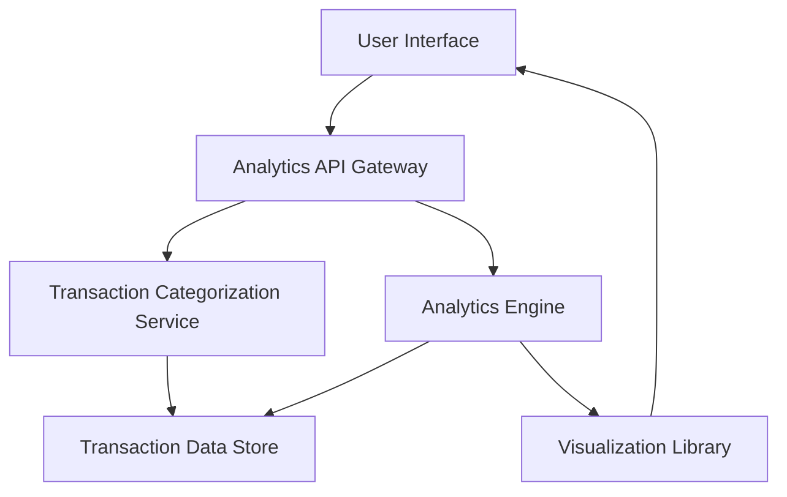

#### 1. High-Level Design

- **Summary:** This epic delivers interactive visualizations and analytical capabilities that enable users to understand their spending patterns through category-wise analysis and monthly spend trends. Users can analyze spending across nine predefined categories (Food & Dining, Fuel, Shopping, Travel, Entertainment, Utilities, Healthcare, Education, and Miscellaneous) as well as view card-wise spend breakdowns.

- **Component Flow:**

- **Integration Points:**
  - **Upstream:** Transaction categorization service for assigning categories to transactions
  - **Internal:** Analytics engine for processing and aggregating spending data
  - **Frontend:** Visualization library for rendering interactive charts

- **Key Assumptions:**
  - Transactions are pre-categorized by the categorization service; category assignment logic is not part of this epic.
  - Monthly spend trends will display data for the current and previous 11 months (12-month rolling window).

- **NFR Highlights:** Analytics visualizations must load within 3 seconds; system must handle complex aggregations efficiently; interactive charts must be responsive and support user interactions smoothly.

- **Data Flow:** User requests spending analytics via the UI, which calls the Analytics API Gateway. The gateway retrieves categorized transaction data from the Transaction Data Store via the Categorization Service, then the Analytics Engine aggregates spending by category, month, and card. The processed data is passed to the Visualization Library, which renders interactive charts and graphs displayed to the user.

#### 2. Validation Report

- **Requirements Coverage:** The design covers all stated scope elements including category-wise spending visualization (9 categories), monthly spend trend analysis, card-wise spend analysis, interactive charts and graphs, and spending pattern identification. The architecture supports the NFRs for load time (3 seconds), efficient aggregations, and responsive interactions. Integration with the transaction categorization service, analytics engine, and visualization library is accounted for. Out-of-scope items (real bank integration, payments, predictive analytics, budget recommendations) are not included in the design.