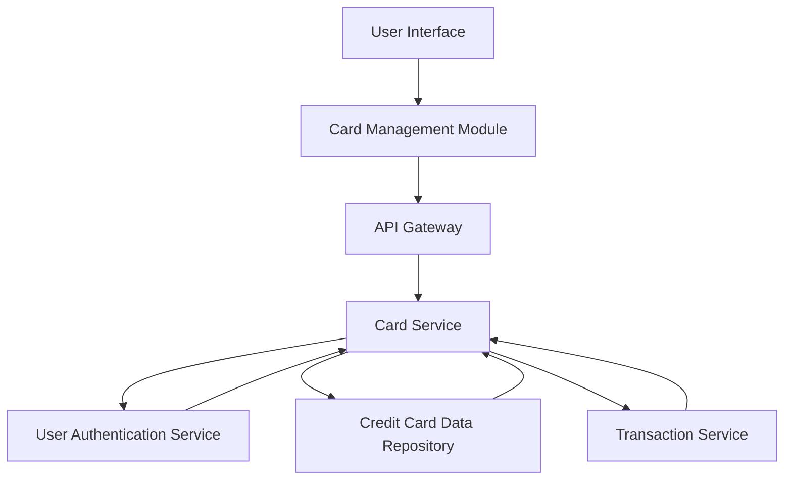

#### 1. High-Level Design

- **Summary:** This epic enables users to view, manage, and analyze multiple credit cards (minimum 10 per user) from a unified interface. Users can access card-specific details, perform card-wise spend analysis, filter and select cards, and view consolidated multi-card summaries. The feature provides comparative insights across cards to support strategic spending decisions.

- **Component Flow:**

- **Integration Points:**
  - **Upstream:** Credit card data repository (provides card metadata, status, limits, balances)
  - **Upstream:** User authentication service (validates card ownership and user identity)
  - **Upstream:** Transaction service (supplies card-specific spending data for analysis)
  - **Downstream:** Card Management UI consumes card lists and details via RESTful APIs

- **Key Assumptions:**
  - Card data repository maintains a normalized card schema with unique card identifiers; card ownership is validated through user authentication tokens.
  - Transaction service provides card-specific spending aggregations on-demand; data retrieval follows pagination patterns for scalability.

- **NFR Highlights:** System must support minimum 10 credit cards per user; card data retrieval within 3 seconds; interface maintains usability with increasing card counts.

- **Data Flow:** User accesses card management interface → API Gateway authenticates via User Authentication Service → Card Service retrieves user's card list from Credit Card Data Repository → For each card, Transaction Service provides spending data → Card Service aggregates and enriches card details → Response returned to UI → UI renders card list with filtering, selection, and card-wise spend analysis views.

#### 2. Validation Report

- **Requirements Coverage:** The design comprehensively covers all scope elements including multiple card display, card-wise spend analysis, individual card details, card selection/filtering, status indicators, and consolidated views. NFRs for supporting 10+ cards per user and 3-second retrieval are addressed through efficient data repository queries and service-level caching. Dependencies on credit card data repository, user authentication service, and transaction service are explicitly integrated. The architecture supports scalability for increasing card counts through pagination and lazy-loading patterns.