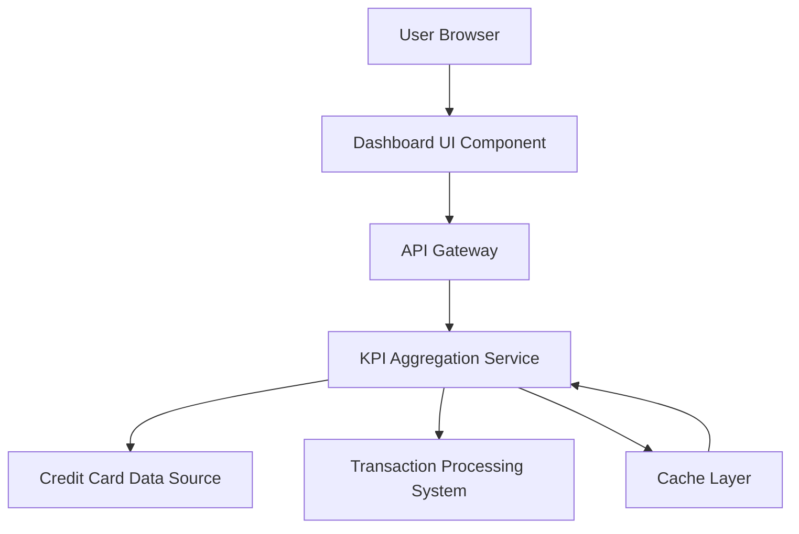

#### 1. High-Level Design

- **Summary:** This epic delivers a centralized dashboard providing real-time visibility into critical credit card KPIs including monthly spend, total credit limit, available credit, and outstanding amounts. The dashboard aggregates data from multiple credit cards to present a unified financial health snapshot, serving as the primary user entry point for credit card management.

- **Component Flow:**

- **Integration Points:**
  - **Upstream:** Credit card data source (for card balances, limits, and status)
  - **Upstream:** Transaction processing system (for monthly spend calculations)
  - **Downstream:** Dashboard UI components consume aggregated KPI data via REST APIs

- **Key Assumptions:**
  - KPI data is assumed to be refreshed in near real-time (within 30-60 seconds) from source systems; data format follows JSON REST API standards.
  - Credit card data source provides standardized card metadata including current balance, credit limit, and available credit fields.

- **NFR Highlights:** Dashboard must load within 2 seconds; support real-time data refresh; responsive design for desktop, tablet, mobile; 99.9% data accuracy.

- **Data Flow:** User requests dashboard → API Gateway authenticates and routes request → KPI Aggregation Service queries Credit Card Data Source for balances/limits and Transaction Processing System for monthly spend → Data is aggregated, cached, and formatted → JSON response returned to Dashboard UI → UI renders KPIs with visual components (cards, charts, metrics).

#### 2. Validation Report

- **Requirements Coverage:** The design fully addresses the epic's scope including monthly spend display, credit limit calculation, available credit computation, outstanding amount tracking, and responsive layout. All specified NFRs (2-second load time, real-time refresh, responsive design, 99.9% accuracy) are incorporated into the architecture through caching, aggregation services, and responsive UI frameworks. Integration dependencies with credit card data source and transaction processing system are explicitly mapped.