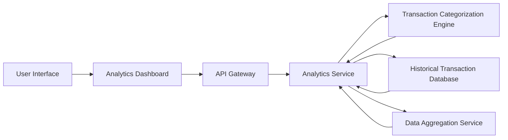

#### 1. High-Level Design

- **Summary:** This epic provides interactive analytics and visualization capabilities for understanding spending patterns across nine predefined categories (Food & Dining, Fuel, Shopping, Travel, Entertainment, Utilities, Healthcare, Education, Miscellaneous). Users can analyze category-wise spending, view monthly spend trends over 12 months, and leverage interactive charts for data-driven financial decisions.

- **Component Flow:**

- **Integration Points:**
  - **Upstream:** Transaction categorization engine (classifies transactions into nine predefined spending categories)
  - **Upstream:** Historical transaction database (stores up to 12 months of transaction history for trend analysis)
  - **Upstream:** Data aggregation service (computes category totals, monthly trends, and spending patterns)
  - **Downstream:** Analytics Dashboard consumes aggregated analytics data and renders interactive visualizations

- **Key Assumptions:**
  - Transaction categorization engine uses rule-based or ML-based classification; category assignments are stored with transaction records for efficient querying.
  - Historical transaction database is indexed by user, date, and category; aggregations are pre-computed daily to meet 5-second query performance requirements.

- **NFR Highlights:** Analytics queries return results within 5 seconds; visualizations render smoothly with 12 months of data; system handles concurrent analytics requests; charts are responsive and interactive.

- **Data Flow:** User requests analytics view → API Gateway routes to Analytics Service → Analytics Service queries Historical Transaction Database filtered by user and date range → Transaction Categorization Engine provides category mappings → Data Aggregation Service computes category-wise totals and monthly trends → Aggregated data formatted as JSON → Analytics Dashboard receives data and renders interactive charts (bar, line, pie charts) → User interacts with visualizations to drill down into specific categories or time periods.

#### 2. Validation Report

- **Requirements Coverage:** The design fully addresses the epic's scope including category-wise spending visualization across nine categories, monthly spend trends, interactive charts, spending pattern analysis, and trend comparison capabilities. All NFRs are incorporated: 5-second query performance through pre-aggregation and database indexing, smooth rendering with 12 months of data via efficient charting libraries, concurrent request handling through scalable service architecture, and responsive interactive charts using modern visualization frameworks. Dependencies on transaction categorization engine, historical transaction database, and data aggregation service are explicitly integrated into the architecture.