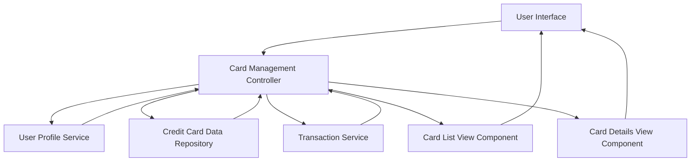

#### 1. High-Level Design

- **Summary:** This epic enables comprehensive credit card portfolio management allowing users to view and monitor multiple credit cards (minimum 10 per user) from a unified interface, track individual card details, view card-specific spending patterns, and analyze card-wise expenditure to optimize card usage with detailed per-card breakdowns.

- **Component Flow:**

- **Integration Points:**
  - **Upstream:** Credit Card Data Repository (provides card information and balances)
  - **Upstream:** User Profile Service (manages card-user associations and user context)
  - **Upstream:** Transaction Service (supplies card-specific spending data for analysis)

- **Key Assumptions:**
  - Card-user associations are maintained in User Profile Service; card ownership changes are reflected in real-time or near-real-time.
  - Card-wise spend analysis aggregates transactions by card ID; transaction attribution to specific cards is accurate and complete.

- **NFR Highlights:** System must support minimum 10 credit cards per user, card data retrieval must complete within 1 second, interface must be responsive across all device types.

- **Data Flow:** User accesses multi-card management interface → Card Management Controller retrieves user profile from User Profile Service to identify associated cards → Controller fetches card details from Credit Card Data Repository and card-specific spending data from Transaction Service → Data is aggregated per card → Card List View Component displays consolidated card listing → User selects specific card → Card Details View Component renders individual card details with spending patterns and balance tracking → User can navigate between cards for card-wise analysis.

#### 2. Validation Report

- **Requirements Coverage:** The design fully satisfies the epic's scope including multiple credit card display, card-wise spend analysis, individual card details view, card listing interface, and card-specific balance tracking. The architecture supports the NFR requirements for minimum 10 cards per user through scalable data repository design, 1-second card data retrieval through optimized controller and service integration, and responsive interface through dedicated view components for both list and detail views across all device types.