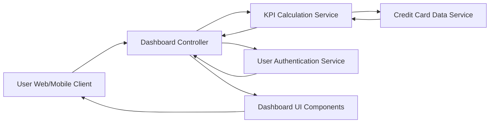

#### 1. High-Level Design

- **Summary:** This epic provides a consolidated dashboard interface displaying real-time key performance indicators (monthly spend, total credit limit, available credit, outstanding amounts) to give users a single-pane-of-glass view of their overall credit card financial health across all cards for informed decision-making.

- **Component Flow:**

- **Integration Points:**
  - **Upstream:** Credit Card Data Service (retrieves card balances and transaction data)
  - **Upstream:** User Authentication Service (provides personalized dashboard access and user context)
  - **Internal:** KPI Calculation Service (aggregates and computes financial metrics)

- **Key Assumptions:**
  - KPI calculations use real-time or near-real-time data; data refresh frequency is defined by the Credit Card Data Service SLA.
  - Available credit is calculated as (Total Credit Limit - Outstanding Amount); no holds or pending transactions are considered.

- **NFR Highlights:** Dashboard must load within 2 seconds, support responsive design for mobile and desktop devices, handle real-time data refresh for KPI updates.

- **Data Flow:** User accesses dashboard → User Authentication Service validates user → Dashboard Controller requests KPI data → KPI Calculation Service fetches card balances and transaction data from Credit Card Data Service → Service calculates monthly spend, total credit limit, available credit, and outstanding amounts → Computed KPIs are returned to Dashboard Controller → Dashboard UI Components render responsive KPI widgets → User views consolidated financial metrics with real-time refresh capability.

#### 2. Validation Report

- **Requirements Coverage:** The design comprehensively addresses the epic's scope including monthly spend display, total credit limit calculation, available credit tracking, outstanding amount monitoring, responsive dashboard layout, and KPI widgets. The architecture supports the NFR requirements for 2-second load time through optimized KPI calculation service, responsive design through dedicated UI components, and real-time data refresh through integration with the Credit Card Data Service.