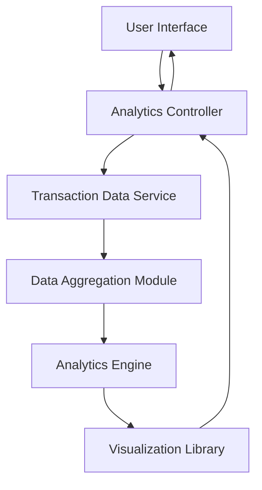

#### 1. High-Level Design

- **Summary:** This epic delivers interactive visualization and analytics capabilities enabling users to understand spending patterns through category-wise breakdowns (Food & Dining, Fuel, Shopping, Travel, Entertainment, Utilities, Healthcare, Education, Miscellaneous) and monthly spend trends. The system analyzes historical transaction data to provide actionable insights for cost optimization and budgeting decisions.

- **Component Flow:**

- **Integration Points:**
  - **Upstream:** Transaction Data Service (provides historical spending records for analysis)
  - **Downstream:** Visualization Library (renders interactive charts and graphs)
  - **Internal:** Analytics Engine (performs data aggregation and pattern analysis)

- **Key Assumptions:**
  - Transaction data is pre-categorized into the 9 defined categories; category assignment logic exists upstream in the transaction service.
  - Monthly aggregation is based on transaction date; timezone handling is consistent across the system.

- **NFR Highlights:** Analytics visualizations must render within 3 seconds, support interactive filtering and drill-down capabilities, handle minimum 12 months of historical transaction data.

- **Data Flow:** User requests spending analytics → Analytics Controller fetches transaction data from Transaction Data Service → Data Aggregation Module groups transactions by category and month → Analytics Engine calculates spending patterns and trends → Visualization Library generates interactive charts → Rendered visualizations are displayed to the user through the UI with filtering and drill-down capabilities.

#### 2. Validation Report

- **Requirements Coverage:** The design fully covers the epic's stated scope including category-wise spending visualization, monthly spend trend analysis, interactive charts, and spending pattern identification across all 9 specified categories. The architecture supports the NFR requirements for 3-second rendering, interactive filtering, and 12 months of historical data handling through dedicated data aggregation and analytics engine components.