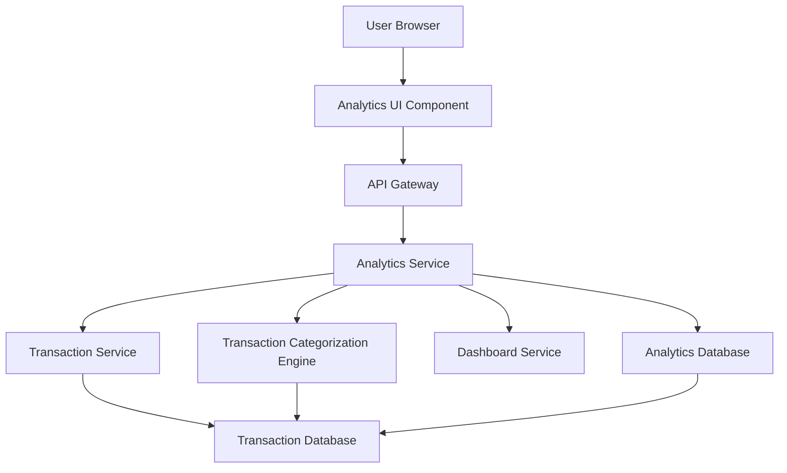

#### 1. High-Level Design

- **Summary:** This epic provides interactive analytics and visualization capabilities for understanding spending patterns and financial behavior. It delivers category-wise spending analysis across nine predefined categories (Food & Dining, Fuel, Shopping, Travel, Entertainment, Utilities, Healthcare, Education, Miscellaneous), monthly spend trend analysis, and interactive charts/graphs. The module empowers users to identify spending patterns, detect anomalies, and make data-driven financial decisions.

- **Component Flow:**

- **Integration Points:**
  - **Upstream:** Dashboard Service (for displaying aggregated metrics in context)
  - **Downstream:** Transaction Service (retrieves transaction data), Transaction Categorization Engine (assigns categories to transactions), Analytics Database/Data Warehouse (stores and retrieves historical data for trend analysis)

- **Key Assumptions:**
  - Transaction categorization uses rule-based or ML engine with 95% accuracy; uncategorized transactions default to "Miscellaneous".
  - Historical data for 12 months is pre-aggregated in Analytics Database for performance optimization.

- **NFR Highlights:** Visualization render time ≤2 seconds; 95% transaction categorization accuracy; interactive and responsive charts across all devices; support for 12 months historical data; real-time category calculation updates.

- **Data Flow:** User accesses analytics view → Analytics UI requests spending data via API Gateway → Analytics Service queries Transaction Service for user transactions → Transaction Categorization Engine assigns categories to transactions → Analytics Service aggregates data by category and time period → For historical trends, Analytics Service queries Analytics Database (pre-aggregated data) → Service computes category-wise breakdowns and monthly trends → Visualization data (JSON) returned to UI → Analytics UI renders interactive charts and graphs (category pie/bar charts, monthly trend line charts) → User interacts with visualizations (filter, drill-down) → UI requests refined data and updates display.

#### 2. Validation Report

- **Requirements Coverage:** The design fully addresses the epic's scope including category-wise spending visualization across all nine predefined categories, monthly spend trend analysis, interactive charts/graphs, transaction categorization, and time-based spending analysis. All NFRs are supported: 2-second render time, 95% categorization accuracy, responsive interactive charts, 12-month historical data support, and real-time category updates. Integration dependencies with Transaction Service, Transaction Categorization Engine, Dashboard Service, and Analytics Database are properly incorporated. The architecture supports the stated user value of providing actionable insights for identifying overspending and optimizing budget allocation.