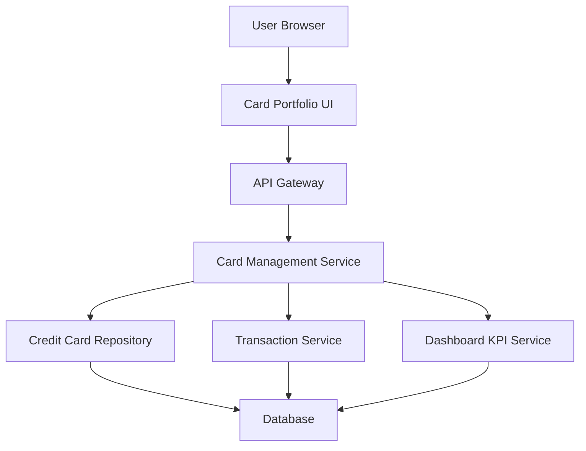

#### 1. High-Level Design

- **Summary:** This epic enables users to manage multiple credit cards from a unified interface. Users can view a list of all their cards, access individual card details, and perform card-wise spend analysis. The feature provides comprehensive tracking of each card's credit limit, available credit, outstanding balance, and spending patterns, supporting efficient portfolio management for users with multiple cards.

- **Component Flow:**

- **Integration Points:**
  - **Upstream:** User Authentication Service (implicit, for user-specific card retrieval)
  - **Downstream:** Credit Card Repository (stores and retrieves card information), Transaction Service (provides card-specific transaction data), Dashboard KPI Service (calculates card-level metrics)

- **Key Assumptions:**
  - Card data is stored in a relational database with indexed user-card relationships for fast retrieval.
  - Card-wise spend analysis aggregates transactions by card ID with monthly granularity.

- **NFR Highlights:** Support minimum 10 cards per user; card list load ≤1.5 seconds; individual card details retrieval ≤1 second; data synchronized across all card views; performance maintained with increasing card count.

- **Data Flow:** User navigates to portfolio view → Card Portfolio UI requests card list via API Gateway → Card Management Service queries Credit Card Repository for user's cards → Card list returned and displayed → User selects specific card → UI requests card details → Card Management Service retrieves card data from Repository, fetches transactions from Transaction Service, and gets metrics from Dashboard KPI Service → Aggregated card-specific data (limit, available credit, outstanding, spending patterns) returned → UI renders individual card detail view with spend analysis.

#### 2. Validation Report

- **Requirements Coverage:** The design comprehensively covers all scope items including multiple card display, individual card detail views, card-wise spend analysis, and card-specific tracking of limits, available credit, and outstanding balances. The card selection and navigation interface is supported through the Card Portfolio UI component. All NFRs are addressed: minimum 10 cards support, load time requirements (1.5s for list, 1s for details), data synchronization, and scalable performance. Integration dependencies with Credit Card Repository, Transaction Service, and Dashboard KPI Service are properly incorporated.