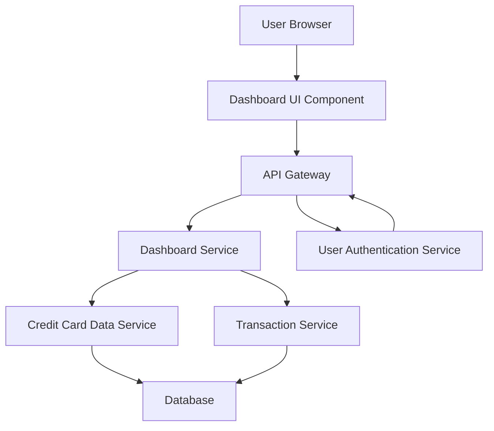

#### 1. High-Level Design

- **Summary:** This epic delivers a centralized dashboard that aggregates and displays critical credit card KPIs including Monthly Spend, Total Credit Limit, Available Credit, and Outstanding Amount. The dashboard provides a consolidated view across all user credit cards, serving as the primary landing page for quick financial health assessment. The interface is responsive and optimized for mobile, tablet, and desktop devices.

- **Component Flow:**

- **Integration Points:**
  - **Upstream:** User Authentication Service (for user identity verification and session management)
  - **Downstream:** Credit Card Data Service (retrieves card details and limits), Transaction Service (calculates monthly spend and outstanding amounts)

- **Key Assumptions:**
  - KPI data is retrieved via RESTful APIs with JSON response format.
  - "Real-time or near real-time" refresh means data synchronization occurs within 5-10 seconds of transaction updates.

- **NFR Highlights:** Dashboard load time ≤2 seconds; responsive design for mobile/tablet/desktop; KPI accuracy to 2 decimal places; real-time/near real-time data refresh.

- **Data Flow:** User authenticates → Dashboard UI requests KPI data via API Gateway → Dashboard Service orchestrates calls to Credit Card Data Service (for limits) and Transaction Service (for spend/outstanding) → Services query Database → Aggregated KPI data returned to Dashboard Service → Dashboard Service computes Available Credit and consolidates metrics → Response sent to UI → Dashboard renders KPIs with responsive layout.

#### 2. Validation Report

- **Requirements Coverage:** The design fully addresses the epic's stated scope including all four KPIs (Monthly Spend, Total Credit Limit, Available Credit, Outstanding Amount), responsive layout, and consolidated multi-card view. Integration dependencies with Credit Card Data Service, Transaction Service, and User Authentication Service are incorporated. NFRs for load time (2 seconds), responsive design, decimal accuracy, and real-time refresh are explicitly supported in the architecture.