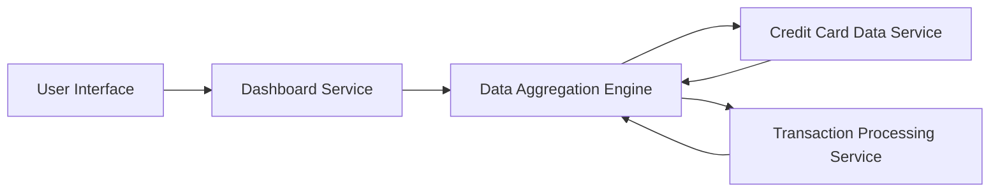

#### 1. High-Level Design

- **Summary:** This epic delivers a centralized, responsive dashboard that provides users with real-time visibility into their credit card portfolio through key performance indicators (KPIs). The dashboard consolidates critical financial metrics including monthly spend, total credit limit, available credit, and outstanding amounts across all credit cards, enabling users to monitor their financial health and make informed spending decisions.

- **Component Flow:**

- **Integration Points:**
  - **Upstream:** Credit card data source/service for retrieving card details and balances
  - **Upstream:** Transaction processing service for calculating monthly spend and outstanding amounts
  - **Downstream:** User interface layer (web, mobile, tablet)

- **Key Assumptions:**
  - Financial data is available through RESTful APIs or similar integration patterns with sub-second response times.
  - KPI calculations (monthly spend, available credit) are performed server-side with cached results to meet the 2-second load time requirement.

- **NFR Highlights:** Dashboard must load within 2 seconds for up to 10 credit cards; responsive design across desktop, tablet, and mobile; near real-time data refresh for financial data.

#### 2. Validation Report

- **Requirements Coverage:** The design fully covers the epic's stated scope including dashboard interface, monthly spend calculation, credit limit aggregation, available credit computation, outstanding amount tracking, and responsive layout. All specified NFRs (2-second load time, multi-device support, real-time data) are addressed through the component architecture with data aggregation engine and caching strategy.