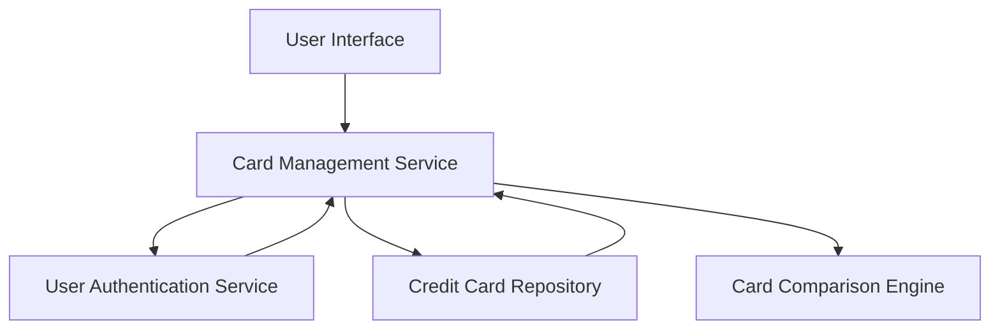

#### 1. High-Level Design

- **Summary:** This epic provides a unified interface for users to view and manage multiple credit cards simultaneously. Users can access all registered credit cards with comprehensive details (card type, credit limit, current balance, card-specific information), switch between cards, compare performance, and understand their overall credit portfolio without accessing multiple banking portals.

- **Component Flow:**

- **Integration Points:**
  - **Upstream:** Credit card data repository or service for storing and retrieving card information
  - **Upstream:** User authentication service for securing card data access
  - **Downstream:** Card display interface with switching and comparison capabilities

- **Key Assumptions:**
  - Card data is stored in a centralized repository accessible via secure APIs with role-based access control.
  - Card comparison logic operates on pre-fetched data to maintain sub-second performance for up to 10 cards per user.

- **NFR Highlights:** System must support at least 10 credit cards per user; card data retrieval within 1 second; interface maintains performance with multiple cards displayed simultaneously.

#### 2. Validation Report

- **Requirements Coverage:** The design comprehensively addresses all scope elements including multiple card display interface, card registration and listing, card-wise spend analysis, individual card detail views, and card comparison capabilities. The architecture supports the specified NFRs through efficient data retrieval patterns and performance-optimized card comparison engine.