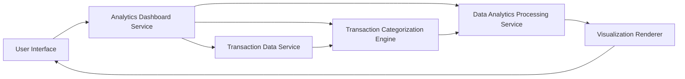

#### 1. High-Level Design

- **Summary:** This epic delivers comprehensive spending analytics through interactive visualizations enabling users to understand spending patterns across predefined categories (Food & Dining, Fuel, Shopping, Travel, Entertainment, Utilities, Healthcare, Education, Miscellaneous). The feature provides monthly spend trend analysis, category-wise breakdowns, and transaction history viewing to support data-driven financial decisions.

- **Component Flow:**

- **Integration Points:**
  - **Upstream:** Transaction data service for retrieving transaction records
  - **Upstream:** Transaction categorization engine or service for classifying transactions into spending categories
  - **Upstream:** Data analytics processing service for trend calculations
  - **Downstream:** Interactive visualization components (charts, graphs, transaction lists)

- **Key Assumptions:**
  - Transaction categorization is automated using ML/rule-based engine with real-time or near real-time processing capabilities.
  - Analytics processing leverages pre-aggregated data and incremental computation to meet the 3-second rendering requirement for up to 1000 transactions.

- **NFR Highlights:** Analytics visualizations must render within 3 seconds for up to 1000 transactions; real-time or near real-time transaction categorization; interactive and responsive charts across all device types.

#### 2. Validation Report

- **Requirements Coverage:** The design fully addresses the epic scope including category-wise spending visualization, monthly spend trend charts, transaction listing and filtering, interactive analytics dashboard, spending pattern analysis, and transaction history display. All NFRs are supported through the architecture with dedicated categorization engine, analytics processing service, and optimized visualization rendering for performance across devices.