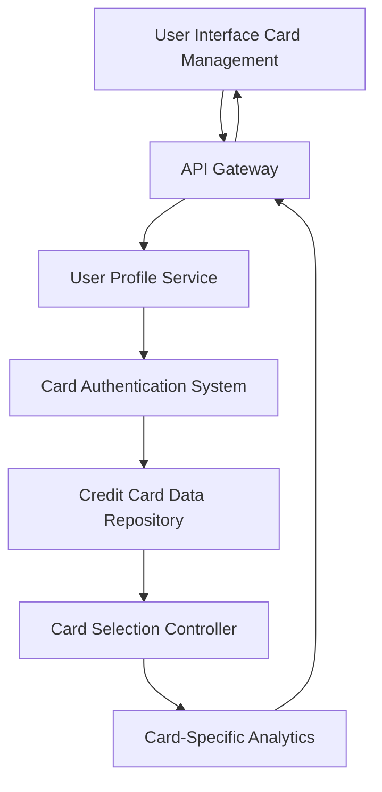

#### 1. High-Level Design

- **Summary**: This epic enables users to manage and view multiple credit cards (up to 10) within a unified interface. Users can add, view, switch between cards, and access card-specific information including limits, balances, spending details, and monthly trends for comparative analysis across their portfolio.

- **Component Flow**:

- **Integration Points**: 
  - **Upstream**: Credit card data repository (stores card details and transaction data), User profile service (manages user-card associations)
  - **Downstream**: Card authentication and verification system (validates card ownership), Card-Specific Analytics (generates per-card metrics)

- **Key Assumptions**: 
  - Card data is stored with user-card mapping in the repository with proper data isolation
  - Card switching uses client-side state management with server-side validation for security

- **NFR Highlights**: Support at least 10 cards per user; instantaneous card switching with no lag; data isolation maintained between cards; responsive interface for mobile card list views

- **Data Flow**: User logs in → User Profile Service retrieves associated cards from Credit Card Data Repository → Card Authentication System validates card ownership → Card list displayed in UI → User selects specific card via Card Selection Controller → Card-Specific Analytics fetches individual card limits, balances, spending details, and monthly trends → Data returned via API Gateway → UI displays card-specific view with option to switch between cards → Data isolation ensures secure separation of card information

#### 2. Validation Report

- **Requirements Coverage**: The design fully addresses all scope requirements including multiple credit card display, card-wise spend analysis, individual card details view, card selection and switching functionality, card-specific balance tracking, and monthly spend trends per card. All NFRs are satisfied: support for 10+ cards per user through scalable Credit Card Data Repository, instantaneous switching via efficient Card Selection Controller with client-side state management, data isolation enforced at repository level, and responsive interface accommodating mobile card list views through adaptive UI components.