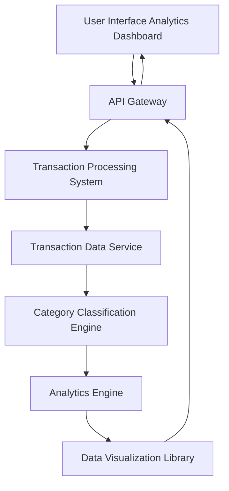

#### 1. High-Level Design

- **Summary**: This epic provides interactive analytics and visualization capabilities for users to analyze spending patterns across predefined categories (Food & Dining, Fuel, Shopping, Travel, Entertainment, Utilities, Healthcare, Education, Miscellaneous). Users can view visual breakdowns, trends, and transaction history to make data-driven budget decisions.

- **Component Flow**:

- **Integration Points**: 
  - **Upstream**: Transaction data service (provides transaction records), Transaction processing system (handles transaction ingestion)
  - **Downstream**: Data visualization library (renders charts/graphs), Category classification engine (categorizes transactions)

- **Key Assumptions**: 
  - Transactions are pre-categorized or classification engine uses rule-based/ML categorization
  - Monthly spend trend analytics covers rolling 12-month period by default

- **NFR Highlights**: Analytics visualizations must render within 3 seconds; support filtering and drill-down; interactive and responsive charts across devices; handle up to 1000 transactions per card per month

- **Data Flow**: User selects analytics view → Request sent via API Gateway → Transaction Processing System retrieves transactions from Transaction Data Service → Category Classification Engine categorizes transactions into predefined categories → Analytics Engine aggregates spending by category and time period → Data Visualization Library generates interactive charts/graphs → Rendered visualizations returned to UI → User interacts with filters and drill-down options for detailed analysis

#### 2. Validation Report

- **Requirements Coverage**: The design comprehensively covers all scope elements including category-wise spending visualization, interactive charts and graphs, transaction categorization, spending pattern analysis, multi-category breakdown, monthly spend trend analytics, and transaction history view. All NFRs are addressed: 3-second render time through optimized Analytics Engine, filtering/drill-down via interactive Data Visualization Library, responsive charts, and capacity to handle 1000 transactions per card per month through efficient Transaction Data Service architecture.