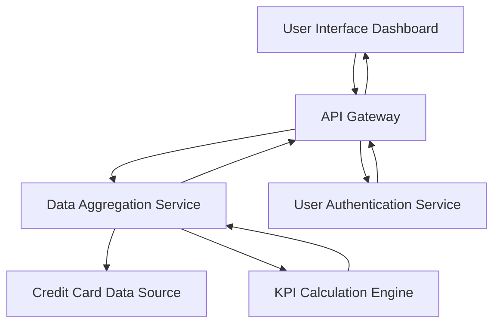

#### 1. High-Level Design

- **Summary**: This epic delivers a consolidated dashboard that displays key financial metrics across all user credit cards, including monthly spend, total credit limit, available credit, and outstanding amounts. The dashboard provides real-time visibility into overall credit health and utilization.

- **Component Flow**:

- **Integration Points**: 
  - **Upstream**: Credit card data source system (provides raw card data), User authentication service (validates user identity)
  - **Downstream**: Data aggregation service (consolidates multi-card metrics)

- **Key Assumptions**: 
  - Credit card data is available via REST API with standardized JSON format
  - Real-time refresh implies polling or webhook-based updates every 30-60 seconds

- **NFR Highlights**: Dashboard must load within 2 seconds; support real-time data refresh; responsive design for desktop and mobile; handle concurrent multi-card viewing without performance degradation

- **Data Flow**: User authenticates → Dashboard requests KPI data via API Gateway → Data Aggregation Service fetches card details from Credit Card Data Source → KPI Calculation Engine computes monthly spend, total limit, available credit, and outstanding amounts → Aggregated metrics returned to Dashboard → UI renders consolidated view with real-time updates

#### 2. Validation Report

- **Requirements Coverage**: The design fully covers the epic's scope including monthly spend display, total credit limit calculation, available credit tracking, outstanding amount monitoring, consolidated multi-card view, and responsive dashboard layout. All NFRs (2-second load time, real-time refresh, responsive design, concurrent multi-card support) are addressed through the API Gateway pattern, Data Aggregation Service, and KPI Calculation Engine architecture.