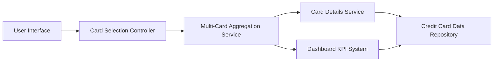

### 1. High-Level Design

**Summary:**  
This epic enables users to view, manage, and compare multiple credit cards (up to 20) within a unified interface. Users can switch between cards, view card-specific details, analyze card-wise spending, and compare metrics across their entire portfolio without leaving the application.

**Component Flow:**

**Integration Points:**
- **Upstream:** Credit Card Data Aggregation Service (consolidates data from multiple card sources)
- **Internal:** Dashboard KPI System (provides card-specific metrics for comparison and analysis)
- **Data Layer:** Card Details Service (retrieves individual card information)

**Key Assumptions:**
- Card data is pre-aggregated and cached to achieve sub-500ms switching response time; no on-demand external API calls during card switching.
- Card comparison uses standardized metric definitions (e.g., utilization rate, spend velocity) consistent across all card types.

**NFR Highlights:**  
System must support up to 20 credit cards per user; card switching response time under 500ms; data synchronization across cards must be consistent.

### 2. Validation Report

**Requirements Coverage:**  
The design addresses all scope items including multiple credit card display, card selection/switching, card-wise spend analysis, individual card details view, and card comparison capabilities. The architecture supports the NFR requirements for 20-card capacity, sub-500ms switching, and consistent data synchronization through the Multi-Card Aggregation Service and caching strategy. Integration with Dashboard KPI system ensures metric consistency.