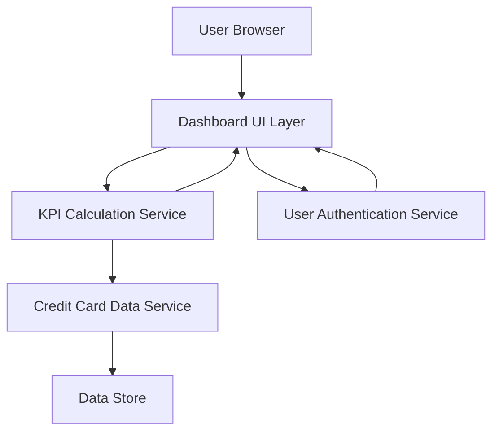

### 1. High-Level Design

**Summary:**  
This epic delivers a consolidated, responsive dashboard that displays key performance indicators (KPIs) for all user credit cards. The dashboard provides real-time visibility into monthly spend, total credit limit, available credit, and outstanding amounts, enabling users to monitor their overall credit card portfolio health from a single interface.

**Component Flow:**

**Integration Points:**
- **Upstream:** User Authentication Service (for secure access control)
- **Downstream:** Credit Card Data Source (for balance, transaction, and limit information)
- **Internal:** KPI Calculation Service (for metric aggregation and real-time refresh)

**Key Assumptions:**
- Credit card data is available via a RESTful API with near-real-time updates (assumed refresh frequency: every 5-15 minutes).
- Available credit is calculated as (Total Credit Limit - Outstanding Amount); no complex credit hold logic is required.

**NFR Highlights:**  
Dashboard must be responsive across desktop, tablet, and mobile devices; page load time under 2 seconds; support real-time data refresh for KPI metrics.

### 2. Validation Report

**Requirements Coverage:**  
The design fully covers the epic's stated scope including dashboard interface, Monthly Spend KPI, Total Credit Limit display, Available Credit calculation, Outstanding Amount tracking, and responsive layout. All specified NFRs (responsiveness, 2-second load time, real-time refresh) are addressed through the architecture. Integration dependencies with credit card data source and authentication service are identified and incorporated.