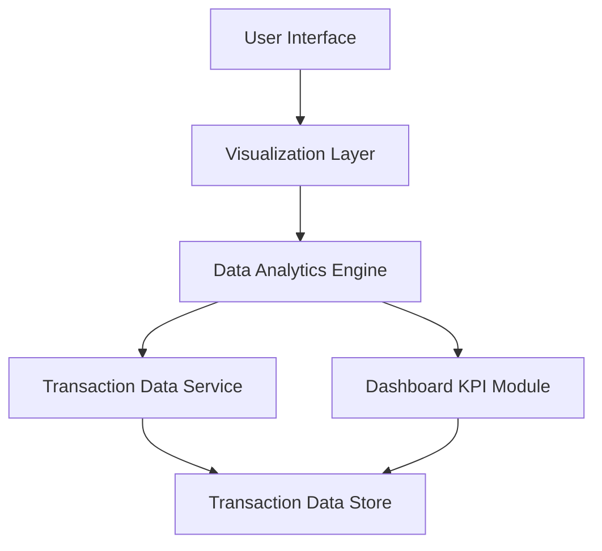

### 1. High-Level Design

**Summary:**  
This epic provides interactive visualizations and analytics to help users understand spending patterns through category-wise breakdowns (9 predefined categories: Food & Dining, Fuel, Shopping, Travel, Entertainment, Utilities, Healthcare, Education, Miscellaneous) and monthly trend analysis over 12 months. The feature enables users to identify spending trends and make informed budgeting decisions.

**Component Flow:**

**Integration Points:**
- **Upstream:** Transaction Data Service (provides categorized transaction data for analysis)
- **Internal:** Dashboard KPI Module (for consolidated metrics integration)
- **Analytics:** Data Analytics Engine (performs trend calculations, pattern identification, and time-based comparisons)

**Key Assumptions:**
- Transactions are pre-categorized by the Transaction Data Service using rule-based or ML-based classification; no manual user categorization required.
- Historical data for 12 months is retained and optimized for query performance; older data is archived.

**NFR Highlights:**  
Analytics visualizations must render within 3 seconds; support historical data analysis for up to 12 months; charts must be interactive and responsive across all device types.

### 2. Validation Report

**Requirements Coverage:**  
The design comprehensively covers all scope elements including category-wise spending visualization (9 categories), monthly spend trends analysis, interactive charts/graphs, spending pattern identification, transaction categorization, and time-based comparisons. The architecture satisfies NFRs through the Data Analytics Engine (3-second render time, 12-month historical support) and responsive Visualization Layer. All specified integrations with Transaction Data Service, Dashboard KPI Module, and Analytics Engine are incorporated.