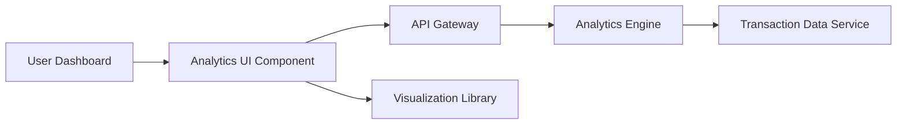

#### 1. High-Level Design

**Summary:** This epic delivers interactive spending analytics with visualizations for monthly spend trends, card-wise breakdowns, and category-wise spending across 9 predefined categories (Food & Dining, Fuel, Shopping, Travel, Entertainment, Utilities, Healthcare, Education, Miscellaneous). The system supports 12+ months of historical analysis with real-time aggregation for up to 1000 transactions per month.

**Component Flow:**

**Integration Points:**
- **Upstream:** Transaction Data Service (for spending data); Analytics Engine (for data aggregation, calculations, and trend analysis)
- **Downstream:** Visualization Library (for rendering interactive charts and graphs)

**Key Assumptions:**
- Transactions are pre-categorized or categorized via rule-based logic; category taxonomy is fixed at 9 categories as specified.
- Analytics calculations (aggregations, trends) are performed server-side and cached for performance optimization.

**NFR Highlights:** Analytics visualizations must render within 3 seconds; support analysis of at least 12 months of historical data; charts must be interactive and responsive across all devices; handle real-time calculation of category aggregations for up to 1000 transactions per month.

#### 2. Validation Report

**Requirements Coverage:** The design comprehensively addresses all scope elements including monthly spend trend visualization, card-wise spend analysis, category-wise spending breakdown (9 categories), interactive charts and graphs, spending pattern identification, multi-dimensional analytics views, and responsive analytics interface. All NFRs are explicitly covered: 3-second rendering time, 12-month historical analysis, cross-device interactivity, and real-time aggregation capacity for 1000 transactions/month. Integration dependencies with Transaction Data Service, Analytics Engine, and Visualization Library are properly reflected in the component architecture.