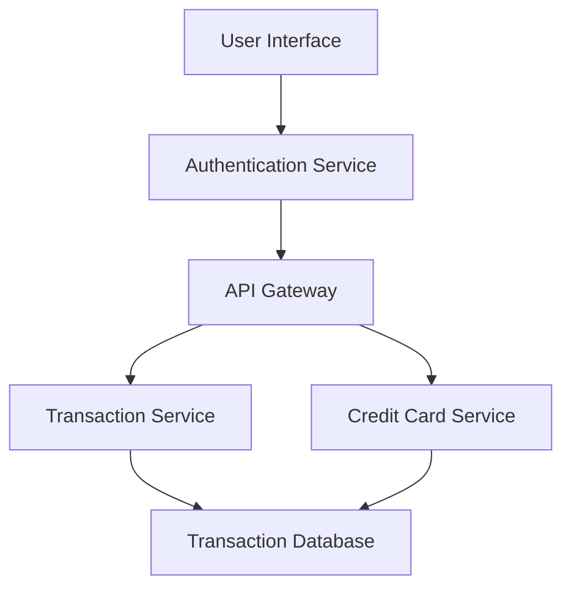

#### 1. High-Level Design

**Summary:** This epic provides comprehensive transaction management capabilities, enabling users to view, search, filter, and analyze credit card transactions across all their cards. The system supports detailed transaction histories with at least 12 months of data per card, with pagination for large datasets and sub-second query response times.

**Component Flow:**

**Integration Points:**
- **Upstream:** User Authentication Service (for secure transaction access); Credit Card Service (for linking transactions to specific cards)
- **Downstream:** Transaction Data Service (for retrieving transaction records with search/filter capabilities)

**Key Assumptions:**
- Transactions are stored with standardized fields (date, amount, merchant, category, card ID) and indexed for fast retrieval.
- Pagination is implemented server-side with configurable page size (assumed 20-50 transactions per page).

**NFR Highlights:** Transaction list must support pagination for large datasets; query response time under 1 second; system must handle 12+ months of transaction history per card; responsive interface across all device types.

#### 2. Validation Report

**Requirements Coverage:** The design fully covers the stated scope including transaction listing, transaction details view, multi-card transaction aggregation, search and filtering, transaction history display, and responsive interface. All NFRs are addressed: pagination support for scalability, sub-second query performance, 12-month history retention, and cross-device responsiveness. Integration dependencies with Transaction Data Service, Credit Card Service, and User Authentication Service are incorporated into the component flow.