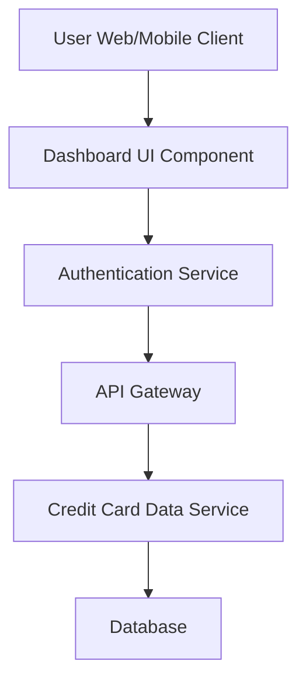

#### 1. High-Level Design

**Summary:** This epic delivers a consolidated dashboard interface that enables users to view and manage multiple credit cards (up to 10 per user) with real-time KPIs including monthly spend, total credit limit, available credit, and outstanding amounts. The dashboard provides a unified financial overview to support better credit utilization decisions.

**Component Flow:**

**Integration Points:**
- **Upstream:** User Authentication Service (for secure access to personal financial data)
- **Downstream:** Credit Card Data Service (for retrieving card details, balances, limits, and spend data)

**Key Assumptions:**
- Credit card data is provided in JSON format via RESTful API endpoints.
- Data refresh occurs via polling or push mechanism with near real-time latency (assumed < 5 seconds).

**NFR Highlights:** Dashboard must load within 2 seconds; support concurrent viewing of up to 10 credit cards per user; responsive design for desktop, tablet, and mobile; near real-time data refresh.

#### 2. Validation Report

**Requirements Coverage:** The design addresses all stated scope elements including Dashboard KPIs display, multiple credit card view, monthly spend tracking, credit limit calculation, available credit display, outstanding amount tracking, and responsive layout. The component flow integrates authentication and credit card data services as specified in dependencies. NFRs for load time (2 seconds), concurrent card support (10 cards), and responsive design are explicitly covered in the architecture.