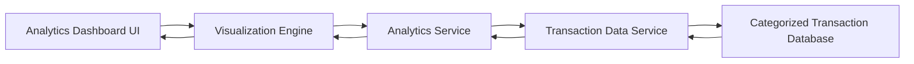

#### 1. High-Level Design

- **Summary:** This epic provides interactive visualizations and analytics for understanding spending patterns across nine predefined categories (Food & Dining, Fuel, Shopping, Travel, Entertainment, Utilities, Healthcare, Education, and Miscellaneous). Users can view monthly trends, analyze category-wise distribution, and identify spending habits through interactive charts for data-driven financial planning.

- **Component Flow:**

- **Integration Points:** 
  - Transaction data service or database for retrieving categorized transaction history
  - Data visualization library or charting service for rendering interactive charts

- **Key Assumptions:** 
  - Transactions are pre-categorized in the data source using the nine defined categories
  - Historical data retention supports at least 12 months of transaction history as specified in NFRs

- **NFR Highlights:** Visualizations must render within 2 seconds; Analytics must support historical data for at least 12 months; Charts must be interactive and responsive across all device types; System must handle large transaction datasets efficiently

#### 2. Validation Report

- **Requirements Coverage:** The design fully covers category-wise spending visualization, monthly trend analysis, interactive charts, spending pattern identification, and multi-category breakdown for all nine specified categories. The architecture ensures visualization rendering within 2 seconds, 12-month historical data support, cross-device responsiveness, and efficient handling of large datasets as mandated by NFRs.