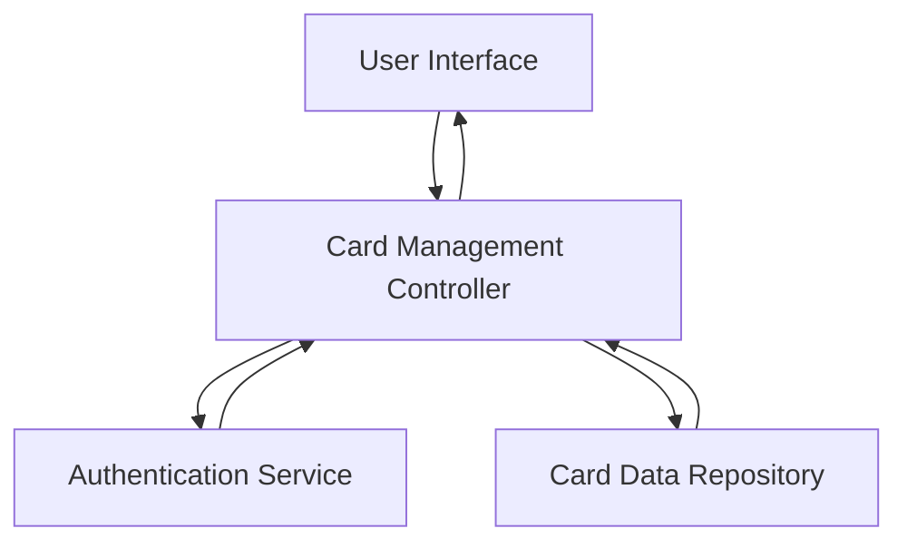

#### 1. High-Level Design

- **Summary:** This epic enables users to add, view, and manage multiple credit cards within a unified interface. Users can view card-specific details, switch between cards, and monitor individual card performance metrics including credit limit, available balance, and outstanding amount for effective multi-account management.

- **Component Flow:**

- **Integration Points:** 
  - Credit card data repository or service layer for storing and retrieving card information
  - User authentication service for secure card data access

- **Key Assumptions:** 
  - Card data is stored with unique identifiers allowing efficient retrieval and switching operations
  - Authentication service provides session-based or token-based access control for card data security

- **NFR Highlights:** System must support management of unlimited number of credit cards per user; Card switching must occur with minimal latency; Interface must maintain responsiveness regardless of number of cards displayed

#### 2. Validation Report

- **Requirements Coverage:** The design addresses all core requirements including multiple card display, card-wise spend analysis, individual card details view, card selection/switching functionality, and card-specific balance tracking. The architecture supports unlimited cards with minimal latency switching as specified in NFRs, with authentication integration ensuring secure access.