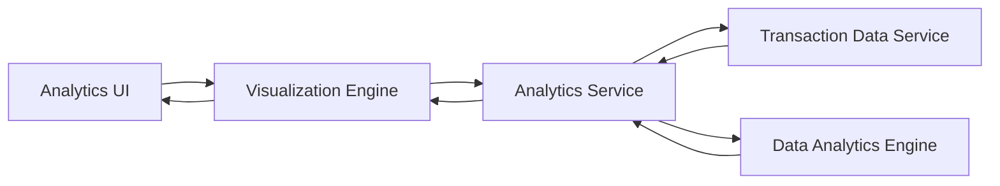

#### 1. High-Level Design

- **Summary:** This epic delivers comprehensive spending analytics through interactive visualizations, enabling users to analyze spending patterns across 9 categories (Food & Dining, Fuel, Shopping, Travel, Entertainment, Utilities, Healthcare, Education, Miscellaneous). The feature provides monthly trend analysis and category-wise breakdowns to help users optimize their financial behavior.

- **Component Flow:**

- **Integration Points:** 
  - **Upstream:** Transaction Data Service (for retrieving categorized transaction history)
  - **Upstream:** Data Analytics Engine (for trend calculation and pattern analysis)
  - **Downstream:** Analytics UI with interactive charts and graphs

- **Key Assumptions:** 
  - Transactions are pre-categorized by the transaction data service into the 9 defined spending categories.
  - Monthly trend calculations are performed asynchronously and cached to support efficient visualization rendering with large datasets.

- **NFR Highlights:** Visualizations must render efficiently with large transaction datasets; Analytics calculations must complete within acceptable time limits; Support for interactive chart interactions without performance degradation.

#### 2. Validation Report

- **Requirements Coverage:** The design comprehensively covers all requirements including category-wise spending visualization, monthly spend trends, interactive charts, transaction categorization, spending pattern identification, and support for 9 spending categories. The architecture separates visualization rendering from analytics computation to meet NFR requirements for performance with large datasets and interactive responsiveness.