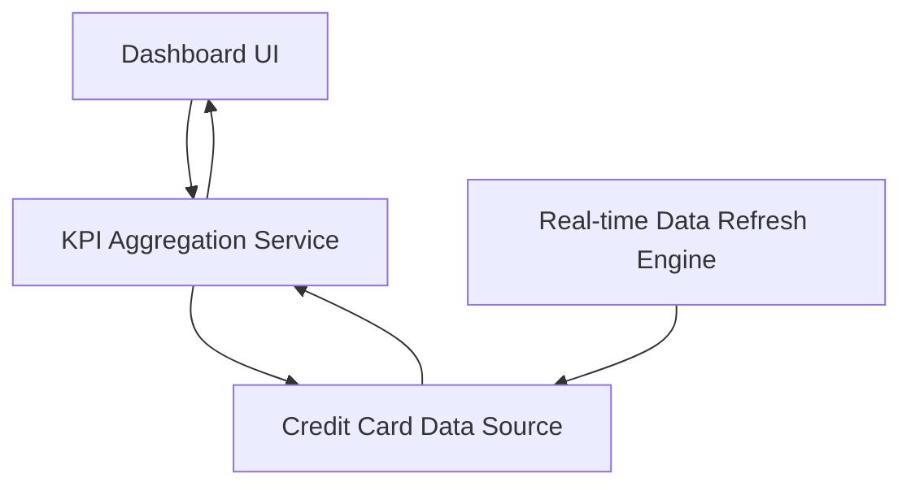

#### 1. High-Level Design

- **Summary:** This epic provides a consolidated dashboard that displays key performance indicators (KPIs) for the user's entire credit card portfolio. Users can monitor monthly spend, total credit limit, available credit, and outstanding amounts in real-time through a modern, responsive interface, enabling comprehensive visibility into their credit card financial health.

- **Component Flow:**

- **Integration Points:** 
  - **Upstream:** Credit Card Data Source or Mock Data Service (for retrieving card balances, limits, and transaction data)
  - **Downstream:** Dashboard UI for KPI visualization and real-time updates

- **Key Assumptions:** 
  - KPI calculations (available credit, outstanding amounts) are computed server-side to ensure consistency across sessions.
  - Real-time refresh is implemented via polling or event-driven updates with configurable refresh intervals.

- **NFR Highlights:** System must support responsive layouts across devices; Dashboard must load and display KPIs with minimal latency; Support for real-time data refresh.

#### 2. Validation Report

- **Requirements Coverage:** The design fully addresses the epic's requirements for dashboard KPI display, monthly spend tracking, credit limit aggregation, available credit calculation, outstanding amount tracking, and responsive layout. The architecture supports real-time data refresh and minimal latency requirements through dedicated aggregation and refresh components.