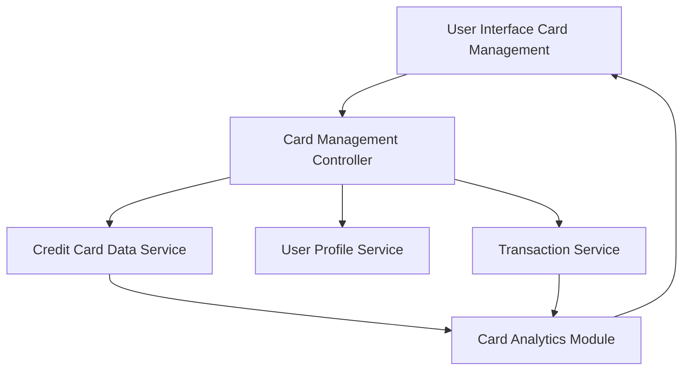

#### 1. High-Level Design

**Summary:**  
This epic enables users to manage and monitor multiple credit cards (up to 10 per user) from a single interface. Users can view all credit cards with individual details, perform card-wise spend analysis, track monthly spending trends per card, and monitor card utilization to optimize their credit card usage strategy.

**Component Flow:**

**Integration Points:**
- **Upstream Systems:**
  - Credit Card Data Service: Supplies individual card information and details
  - User Profile Service: Links credit cards to user accounts
  - Transaction Service: Provides card-specific transaction history for spend analysis
- **Downstream Systems:**
  - Card Analytics Module: Aggregates and presents card-wise spending trends and utilization metrics

**Key Assumptions:**
- Card data is cached at the user session level to meet 1-second retrieval requirement for subsequent card views
- Card utilization percentage is calculated as (outstanding balance / credit limit) × 100 and updated with each transaction sync

**NFR Highlights:**  
System must support viewing and managing at least 10 credit cards per user, card data retrieval must complete within 1 second, ensure data consistency across card views

#### 2. Validation Report

**Requirements Coverage:**  
The design fully satisfies the epic's scope including multiple credit card display, card-wise spend analysis, monthly spend trends per card, card details viewing, and card utilization tracking. The architecture supports the NFR of managing at least 10 cards per user with 1-second data retrieval through caching strategies in the Card Management Controller. Integration with Credit Card Data Service, User Profile Service, and Transaction Service ensures comprehensive card management capabilities. The Card Analytics Module provides the necessary aggregation for spend trends and utilization metrics while maintaining data consistency across views.