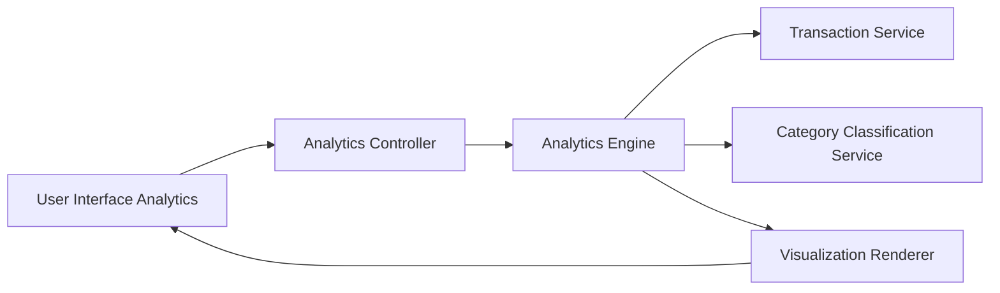

#### 1. High-Level Design

**Summary:**  
This epic provides interactive visualizations and analytics to help users understand spending patterns across 9 predefined categories (Food & Dining, Fuel, Shopping, Travel, Entertainment, Utilities, Healthcare, Education, Miscellaneous). Users can analyze transactions, identify spending trends, and make data-driven financial decisions based on historical transaction data.

**Component Flow:**

**Integration Points:**
- **Upstream Systems:**
  - Transaction Service: Provides raw transaction data for analysis
  - Category Classification Service: Categorizes transactions into predefined categories
  - Analytics Engine: Generates spending insights and aggregations
- **Downstream Systems:**
  - Visualization components: Render interactive charts and graphs for user consumption

**Key Assumptions:**
- Transaction categorization is pre-computed and stored (not performed on-demand) to support 3-second rendering requirement
- Analytics support filtering by date range, category, and card with server-side pagination for datasets exceeding 10,000 records

**NFR Highlights:**  
Analytics visualizations must render within 3 seconds, support filtering and drill-down capabilities, handle transaction datasets of up to 10,000 records per user efficiently

#### 2. Validation Report

**Requirements Coverage:**  
The design comprehensively addresses the epic's scope including category-wise spending visualization, interactive charts and graphs, transaction categorization, spending pattern analysis, multi-category support for 9 predefined categories, and transaction history view. The architecture incorporates the Category Classification Service and Analytics Engine to meet the 3-second rendering NFR while supporting drill-down and filtering capabilities. The design accounts for efficient handling of up to 10,000 transaction records through the Analytics Engine's aggregation and pagination capabilities.