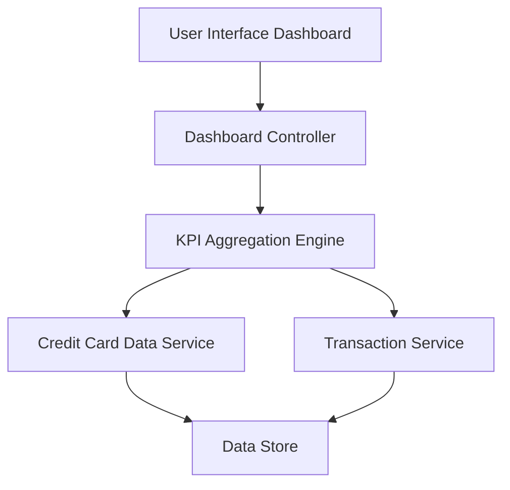

#### 1. High-Level Design

**Summary:**  
This epic delivers a centralized dashboard that displays key performance indicators (KPIs) for a user's credit card portfolio, including monthly spending, total credit limit, available credit, and outstanding amounts. The dashboard provides a consolidated financial snapshot enabling informed credit utilization and spending decisions.

**Component Flow:**

**Integration Points:**
- **Upstream Systems:**
  - Credit Card Data Service: Provides card balances and credit limits
  - Transaction Service: Supplies monthly spend data and outstanding amounts
- **Downstream Systems:**
  - User Interface: Consumes aggregated KPI data for visualization

**Key Assumptions:**
- KPI data is refreshed in near real-time (assumed refresh interval of 30-60 seconds for balance updates)
- Credit limit and available credit calculations are performed server-side with cached results to meet 2-second load requirement

**NFR Highlights:**  
Dashboard must load within 2 seconds, support responsive design for mobile and desktop, handle real-time data refresh for KPI updates

#### 2. Validation Report

**Requirements Coverage:**  
The design fully covers the epic's stated scope including monthly spend tracking, total credit limit display, available credit calculation, outstanding amount monitoring, responsive dashboard layout, and KPI visualization. The component architecture supports the required NFRs through the KPI Aggregation Engine which can cache and serve data within the 2-second load time constraint. Integration dependencies with Credit Card Data Service and Transaction Service are properly identified and incorporated into the design.