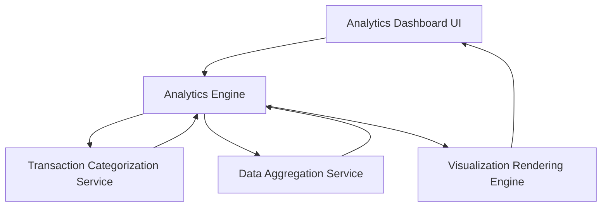

#### 1. High-Level Design

- **Summary:** This epic provides interactive data visualizations and analytical capabilities for understanding spending patterns through category-wise breakdowns and monthly trend analysis. Users can explore spending across nine predefined categories and view monthly trends to identify patterns and optimize budgets.

- **Component Flow:**

- **Integration Points:**
  - **Upstream:** None explicitly mentioned
  - **Downstream:** Transaction Categorization Service (for category assignment to transactions), Analytics Engine (for trend calculation), Data Aggregation Service (for monthly summaries and historical data processing)

- **Key Assumptions:**
  - Transactions are auto-categorized into one of nine categories (Food & Dining, Fuel, Shopping, Travel, Entertainment, Utilities, Healthcare, Education, Miscellaneous) using rule-based or ML classification.
  - Historical data is retained for minimum 12 months with monthly granularity for trend analysis.

- **NFR Highlights:** Analytics visualizations must render within 3 seconds, support interactive filtering and drill-down capabilities, and handle minimum 12 months of historical transaction data for trend analysis.

- **Data Flow:** User accesses analytics dashboard → Analytics Engine requests categorized transaction data from Transaction Categorization Service → Service returns transactions with assigned categories → Engine queries Data Aggregation Service for monthly spend summaries across 12+ months → Aggregation Service computes category-wise totals and monthly trends → Analytics Engine processes data for visualization (pie charts for category breakdown, line charts for monthly trends) → Visualization Rendering Engine generates interactive charts with filtering and drill-down capabilities → User interacts with visualizations to filter by category, time period, or drill into specific transactions → Updated visualizations render within 3 seconds showing spending patterns and insights.

#### 2. Validation Report

- **Requirements Coverage:** The design fully addresses the epic's scope including category-wise spending visualization, monthly spend trend charts, interactive analytics dashboard, nine spending categories support, spending pattern identification, and visual data representation. The architecture supports all NFRs with dedicated rendering engine for sub-3-second visualization performance, interactive filtering capabilities through the analytics engine, and data aggregation service capable of processing 12+ months of historical data for comprehensive trend analysis.