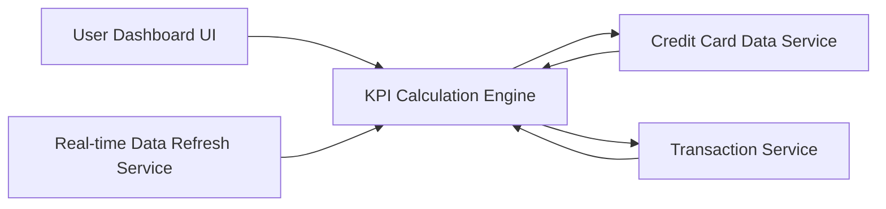

#### 1. High-Level Design

- **Summary:** This epic delivers a consolidated dashboard interface displaying real-time key performance indicators for credit card financial health, including monthly spend, total credit limit, available credit, and outstanding amounts across all credit cards. The dashboard provides a single-pane view for quick assessment and informed decision-making.

- **Component Flow:**

- **Integration Points:**
  - **Upstream:** Real-time Data Refresh Service (for periodic KPI updates)
  - **Downstream:** Credit Card Data Service (for retrieving card balances and limits), Transaction Service (for calculating monthly spend and outstanding amounts)

- **Key Assumptions:**
  - Monthly spend is calculated based on current calendar month with daily aggregation.
  - Outstanding amounts include both posted and pending transactions with clear distinction in data model.

- **NFR Highlights:** Dashboard must load within 2 seconds, support responsive design for mobile and desktop devices, and handle real-time data refresh for KPI updates.

- **Data Flow:** User accesses dashboard → Dashboard UI requests KPI data from KPI Calculation Engine → Engine queries Credit Card Data Service for total credit limit and available credit across all cards → Engine queries Transaction Service for monthly spend and outstanding amounts → Services return aggregated data → Engine calculates consolidated KPIs (total limit, total available credit, total monthly spend, total outstanding) → Real-time Data Refresh Service triggers periodic updates → Calculated KPIs are rendered on responsive dashboard UI with visual indicators for credit utilization and spending trends.

#### 2. Validation Report

- **Requirements Coverage:** The design comprehensively addresses all stated requirements including monthly spend display, total credit limit calculation, available credit tracking, outstanding amount monitoring, responsive dashboard layout, and consolidated KPI view. The architecture supports the NFR requirements with dedicated calculation engine for sub-2-second load times, responsive UI framework for multi-device support, and real-time refresh service for data currency.