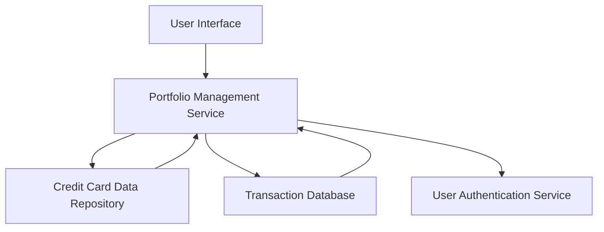

#### 1. High-Level Design

- **Summary:** This epic provides a unified interface for users to manage and monitor multiple credit cards, displaying comprehensive details including limits, balances, and transaction history. Users can view all cards in a consolidated portfolio view, navigate between cards, and access card-specific information efficiently.

- **Component Flow:**

- **Integration Points:**
  - **Upstream:** User Authentication Service (for secure card access and user identity verification)
  - **Downstream:** Credit Card Data Repository (for retrieving card information, limits, balances), Transaction Database (for card-specific transaction retrieval)

- **Key Assumptions:**
  - Card data is pre-populated in the credit card data repository with standardized schema (card number, limit, balance, issuer).
  - Transaction history is available in near real-time with a maximum delay of 5 minutes from transaction occurrence.

- **NFR Highlights:** System must support minimum 10 credit cards per user with card switching response time under 500ms and maintain data consistency across card views.

- **Data Flow:** User authenticates and requests portfolio view → Portfolio Management Service queries Credit Card Data Repository for all user cards → Service retrieves card details (limits, balances, issuer info) → Service queries Transaction Database for recent transactions per card → Aggregated data is returned to UI → User selects specific card → Service fetches detailed card information and full transaction history → Data is displayed in card-specific view with navigation controls.

#### 2. Validation Report

- **Requirements Coverage:** The design fully covers the epic's stated scope including multiple credit card display, card-wise spend analysis, individual card details view, card selection and navigation, transaction listing per card, and card portfolio overview. All NFRs regarding user capacity (10+ cards), performance (sub-500ms switching), and data consistency are addressed through the service-oriented architecture with dedicated data repositories.