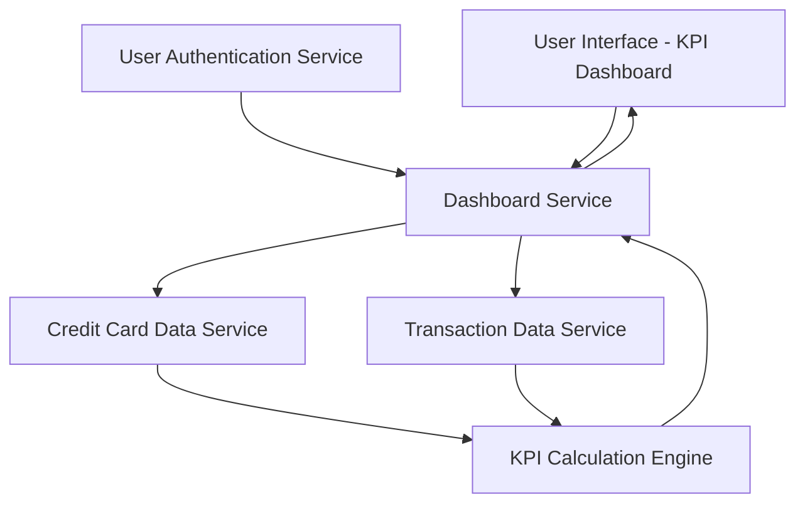

#### 1. High-Level Design

- **Summary:** This epic delivers a consolidated dashboard displaying key performance indicators (KPIs) for the user's credit card portfolio. Core requirements include real-time visibility into monthly spend, total credit limit, available credit, and outstanding amount across all cards. The scope covers KPI calculation, visualization, responsive layout, and real-time data updates.

- **Component Flow:**

- **Integration Points:**
  - **Upstream:** User Authentication Service (for secure access), Credit Card Data Service (for card balances and limits), Transaction Data Service (for transaction data and monthly spend)
  - **Downstream:** User Interface (for KPI visualization and responsive display)

- **Key Assumptions:** 
  - Credit card data service provides near real-time balance and limit data; "real-time" refers to data freshness within acceptable SLA (e.g., 5-minute lag)
  - KPI calculations (total credit limit, available credit, outstanding amount) are performed server-side by the KPI Calculation Engine

- **NFR Highlights:** Dashboard must load within 2 seconds, support responsive design for mobile and desktop, handle real-time data updates for KPI metrics

- **Data Flow:** User logs in via User Authentication Service → Dashboard Service authenticates user → Service fetches card balances, limits, and outstanding amounts from Credit Card Data Service and monthly spend from Transaction Data Service → KPI Calculation Engine computes aggregated KPIs (total credit limit, available credit, outstanding amount, monthly spend) → Dashboard Service returns KPIs to UI → Responsive dashboard displays KPIs with real-time updates

#### 2. Validation Report

- **Requirements Coverage:** The design covers all stated scope: monthly spend display, total credit limit calculation, available credit tracking, outstanding amount monitoring, responsive dashboard layout, and KPI visualization. All dependencies (credit card data service, transaction data service, user authentication service) are integrated. NFRs for performance (2-second load time), responsiveness (mobile and desktop), and real-time updates are addressed. Out-of-scope items (real bank integration, payments, fund transfers, loans, payment gateway) are excluded as specified.