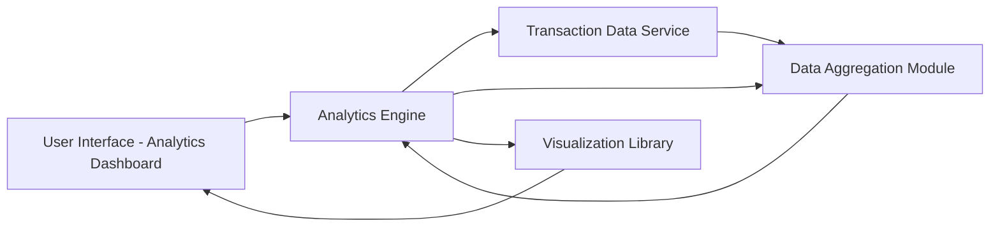

#### 1. High-Level Design

- **Summary:** This epic provides interactive analytics and visualizations to help users understand spending patterns. Core requirements include monthly spend trend visualization over time and category-wise spending breakdown across 9 predefined categories (Food & Dining, Fuel, Shopping, Travel, Entertainment, Utilities, Healthcare, Education, Miscellaneous). The scope encompasses interactive charts, trend analysis, and pattern identification.

- **Component Flow:**

- **Integration Points:**
  - **Upstream:** Transaction Data Service (for historical spending data), Analytics Engine (for data aggregation and categorization)
  - **Downstream:** Visualization Library (for rendering charts and graphs), User Interface (for interactive filtering and drill-down)

- **Key Assumptions:** 
  - Transactions are pre-categorized by the transaction data service into the 9 predefined categories; manual re-categorization is not in scope
  - Historical data is retained for at least 12 months and is accessible via the transaction data service

- **NFR Highlights:** Analytics visualizations must render within 3 seconds, support interactive filtering and drill-down, handle 12 months of historical data

- **Data Flow:** User accesses analytics dashboard → Analytics Engine queries Transaction Data Service for historical spending data → Data Aggregation Module processes and categorizes transactions by month and category → Aggregated data is passed to Visualization Library → Interactive charts (monthly trends, category breakdown) are rendered in UI → User can filter by date range or category for drill-down analysis

#### 2. Validation Report

- **Requirements Coverage:** The design addresses all scope elements: monthly spend trends, category-wise analysis, interactive charts, spending pattern identification, multi-category breakdown, and trend analysis over time. All dependencies (transaction data service, analytics engine, visualization library) are integrated. NFRs for performance (3-second rendering), interactivity (filtering/drill-down), and data retention (12 months) are incorporated. Out-of-scope items (real bank integration, payments, predictive analytics, budget recommendations) are excluded as specified.