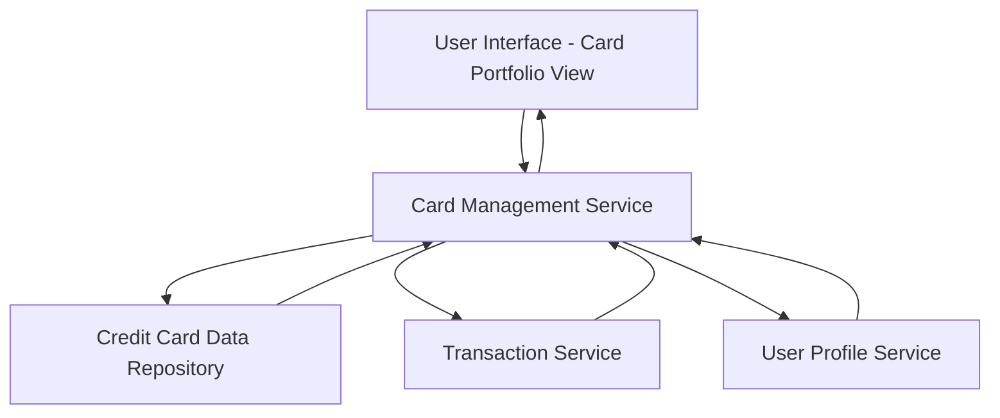

#### 1. High-Level Design

- **Summary:** This epic delivers a consolidated interface for users to view and manage multiple credit cards simultaneously. The core requirement is to display all user credit cards with individual card details (balances, limits), provide card-wise spending analysis, and enable comparison across the portfolio. The scope includes card listing, filtering, selection, and detailed card-level spend tracking.

- **Component Flow:**

- **Integration Points:**
  - **Upstream:** User Profile Service (for card-user associations), Credit Card Data Repository (for card information and balances), Transaction Service (for card-wise spending data)
  - **Downstream:** User Interface layer consuming card portfolio data

- **Key Assumptions:** 
  - Card data is provided in a standardized format (JSON/REST API) from the credit card data repository
  - Card-wise spending is pre-aggregated by the transaction service; real-time transaction categorization is not required at this layer

- **NFR Highlights:** System must support at least 10 credit cards per user, card data retrieval within 1 second, responsive design across all device types

- **Data Flow:** User requests card portfolio → Card Management Service authenticates via User Profile Service → Service fetches card details from Credit Card Data Repository and spending data from Transaction Service → Aggregated data (card list with balances, limits, and spend) is returned to UI → User can filter/select cards to view detailed analysis for individual cards

#### 2. Validation Report

- **Requirements Coverage:** The design covers all stated scope elements: multiple credit card display, card-wise spend analysis, individual card details, card selection/filtering, and consolidated portfolio view. The architecture integrates all specified dependencies (credit card data repository, transaction service, user profile service) and meets the NFRs for performance (1-second retrieval), scale (10+ cards), and responsiveness. Out-of-scope items (real bank integration, payments, fund transfers) are explicitly excluded from the design.