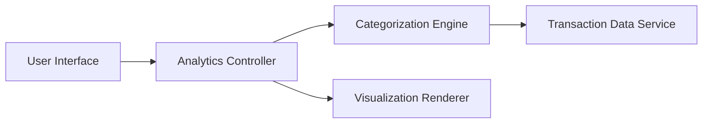

#### 1. High-Level Design

- **Summary:** This epic provides interactive visualizations and analytics to help users understand spending behavior across multiple categories (Food & Dining, Fuel, Shopping, Travel, Entertainment, Utilities, Healthcare, Education, Miscellaneous). It includes monthly spend trend analysis, enabling users to track patterns over time and identify optimization opportunities for expense management.

- **Component Flow:**

- **Integration Points:**
  - **Upstream:** Transaction data service for retrieving categorized transaction history; Categorization engine/service for automatic transaction classification
  - **Downstream:** Visualization components (charts/graphs) in the user interface for rendering interactive analytics

- **Key Assumptions:**
  - Transactions are either pre-categorized or categorized automatically using a classification engine with predefined rules or ML models.
  - Monthly trend calculations aggregate historical transaction data over a configurable time period (e.g., last 12 months) with acceptable query performance.

- **NFR Highlights:** Visualizations must be interactive and responsive; Analytics calculations must process transaction data efficiently; Charts must render within acceptable time frames for good user experience.

#### 2. Validation Report

- **Requirements Coverage:** The design fully addresses the epic's scope including category-wise spending visualization, monthly spend trends, interactive charts and graphs, spending pattern analysis, multi-category breakdown across all specified categories, and transaction categorization. The architecture leverages a Categorization Engine for automatic classification and a Visualization Renderer for interactive chart generation. The separation of analytics processing from visualization rendering ensures that the NFR requirements for interactivity, responsiveness, and efficient data processing are met while maintaining acceptable rendering performance.