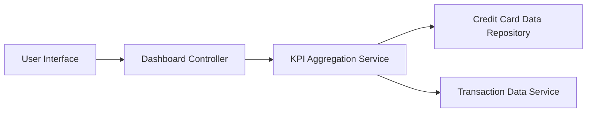

#### 1. High-Level Design

- **Summary:** This epic delivers a consolidated dashboard that displays key performance indicators (KPIs) for the user's credit card portfolio. The dashboard provides real-time visibility into monthly spend, total credit limit, available credit, and outstanding amounts across all credit cards through a responsive, modern interface optimized for desktop, tablet, and mobile devices.

- **Component Flow:**

- **Integration Points:**
  - **Upstream:** Credit card data source/database for retrieving card balances, limits, and transaction data
  - **Downstream:** User interface layer (web/mobile) for rendering responsive dashboard components

- **Key Assumptions:**
  - Data refresh frequency is assumed to be near real-time or at regular intervals (e.g., every few minutes) to ensure KPIs reflect current financial status.
  - Credit card data is pre-aggregated or can be aggregated on-demand with acceptable performance for dashboard load times.

- **NFR Highlights:** Dashboard must be responsive across desktop, tablet, and mobile devices; Page load time must be optimized for quick access to financial data.

#### 2. Validation Report

- **Requirements Coverage:** The design fully covers the epic's stated scope including dashboard KPI display, monthly spend tracking, total credit limit display, available credit calculation, outstanding amount tracking, and responsive layout design. The component flow ensures data retrieval from the credit card repository and transaction service, aggregation through the KPI service, and presentation via the dashboard controller to the user interface. The architecture supports the NFR requirements for responsiveness and optimized page load times through a dedicated aggregation service layer.