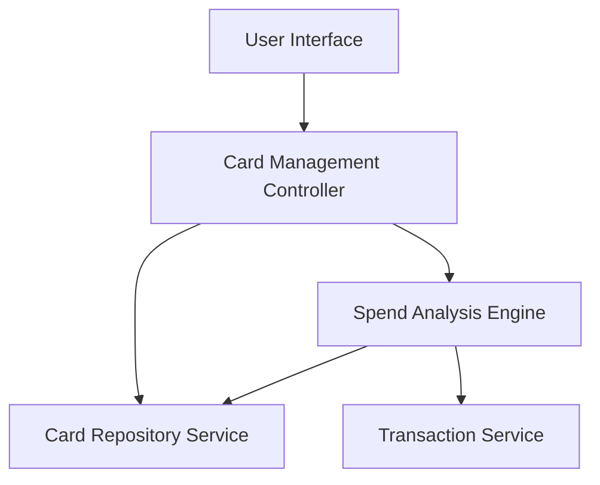

#### 1. High-Level Design

- **Summary:** This epic enables users to manage and view multiple credit cards within the application. It provides a consolidated view of all cards, access to card-specific details, and card-wise spend analysis. Users can select, filter, and analyze spending patterns for individual cards to understand utilization and optimize card benefits.

- **Component Flow:**

- **Integration Points:**
  - **Upstream:** Credit card data repository for storing and retrieving multiple card information; Transaction service for card-wise spending data
  - **Downstream:** User interface for displaying multiple cards, card details, and spend analysis visualizations

- **Key Assumptions:**
  - Card data structure supports unique identification for each card to enable card-wise filtering and analysis.
  - Spend analysis calculations are performed on-demand or pre-computed periodically to maintain performance with increasing number of cards.

- **NFR Highlights:** System must support viewing and analyzing data for multiple credit cards simultaneously; Interface must maintain performance with increasing number of cards.

#### 2. Validation Report

- **Requirements Coverage:** The design comprehensively addresses the epic's scope including multiple credit card display, card-wise spend analysis, individual card details view, card selection and filtering, and card-specific balance tracking. The architecture introduces a dedicated Spend Analysis Engine that works with both the Card Repository Service and Transaction Service to provide card-specific insights. The design supports the NFR requirement for handling multiple cards simultaneously while maintaining performance through separation of concerns between card management and spend analysis components.